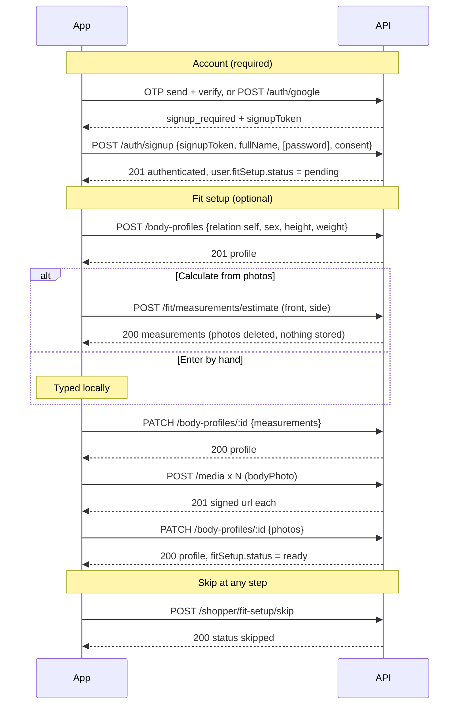

# Backend request: signup and fit setup APIs

Version 1.0 — 8 October 2026
Audience: backend team. Owner: Flutter app.

Base URL:

```text
https://redressbackend.cyberimpulses.com/api/v1
```

**Give this file + [`backend-shop-commerce-api.md`](./backend-shop-commerce-api.md) to backend.** Cover sheet: [`BACKEND-HANDOFF.md`](./BACKEND-HANDOFF.md).

This file is **signup + consent + fit setup + body profiles only**. Categories, bag, checkout, and orders are in the shop file.

Existing login, OTP send/verify, refresh, logout, forgot-password, and `PATCH /auth/me` do **not** change — they stay as in [`auth-flows.md`](./auth-flows.md).

---

## 0. Summary

The new signup has two independent layers.

| Layer | What | Required |
| --- | --- | --- |
| Account | Proof (phone OTP, email OTP, or Google), name, privacy consent | Yes |
| Fit setup | Sex, height, weight, measurements, body photos | No. Skippable at every step |

The app flow after the account exists:

| Step | Screen | What the app sends |
| --- | --- | --- |
| 1 | About you | `POST` or `PATCH /body-profiles` (sex, height, weight) |
| 2 | Method | Nothing |
| 3 | Measurement photos (only when the shopper chose "from photos") | `POST /fit/measurements/estimate` with 2 photos. **The server must not store these photos.** |
| 4 | Review measurements | `PATCH /body-profiles/:id` (measurements) |
| 5 | Profile photos (optional) | `POST /media` per photo, then one `PATCH /body-profiles/:id` (photos). **These are stored, privately.** |
| Any | Skip | `POST /shopper/fit-setup/skip` |

### Endpoint index

| # | Method | Path | Status | Priority |
| --- | --- | --- | --- | --- |
| 1 | POST | `/auth/otp/send` | Exists, unchanged | — |
| 2 | POST | `/auth/otp/verify` | Exists, unchanged | — |
| 3 | POST | `/auth/login` | Exists, unchanged | — |
| 4 | GET | `/content/policies/privacy` | Exists, unchanged. Its `updatedAt` is the consent version | — |
| 5 | POST | `/auth/signup` | **Changed**: required `consent`, field rules | P0 |
| 6 | POST | `/auth/google` | **Changed**: new person gets `signup_required`, no user created | P0 |
| 7 | GET | `/auth/me` and every `data.user` | **Changed**: adds `consent`, `fitSetup` | P0 |
| 8 | POST | `/auth/consent` | **New** | P1 |
| 9 | POST | `/body-profiles` | **Changed**: `sex`, `self_exists` | P1 |
| 10 | GET | `/body-profiles` | **Changed**: returns `sex` | P1 |
| 11 | PATCH | `/body-profiles/:id` | **Changed**: `sex`, signed photo URLs | P1 |
| 12 | POST | `/media` (`bodyPhoto`) | **Changed**: private storage, signed URLs | P1 |
| 13 | POST | `/shopper/fit-setup/skip` | **New** | P1 |
| 14 | POST | `/fit/measurements/estimate` | **New**. Stateless photo analysis, nothing stored | P2 |

Priorities:

- **P0** is needed to ship the new signup screens. Without it the app cannot create an account with consent.
- **P1** is needed for fit setup to persist on the server.
- **P2** can ship later. If the endpoint answers `404` or `503`, the app tells the shopper to enter measurements by hand and the rest of the flow still works.

### Not needed any more (earlier design)

`GET /body-profiles/:id/estimate/:estimateId` is dropped. The signup flow uses the stateless endpoint 14, which answers in one call. The existing `POST /body-profiles/:id/estimate` (estimate from photos already stored on a profile) stays as it is, for the body-profile editor.

---

## 1. Shared rules (unchanged, repeated for convenience)

Headers on every call:

```http
Accept: application/json
Content-Type: application/json
Accept-Language: it
```

`it` or `en`. Missing or anything else means Italian. Protected calls also send `Authorization: Bearer <accessToken>`.

Success body: `{ "data": { ... } }`.

Error body:

```json
{
  "errorCode": "UNPROCESSABLE",
  "messageKey": "errorUnprocessable",
  "details": {
    "retryable": false,
    "fields": { "consent": "required" }
  }
}
```

| HTTP | errorCode | Meaning |
| --- | --- | --- |
| 400 | `VALIDATION` | Missing or badly shaped field |
| 401 | `SESSION_EXPIRED` / `SESSION_CLOSED` | Access session is over |
| 404 | `NOT_FOUND` | Unknown id or not yours |
| 409 | `CONFLICT` | Already exists |
| 422 | `INVALID_CREDENTIALS` | Wrong OTP / password / Google token rejected |
| 422 | `UNPROCESSABLE` | Business rule failed. `details.fields` or `details.reason` says which |
| 429 | `RATE_LIMITED` | Too many calls. `retryable: true` |
| 503 | `SERVICE_UNAVAILABLE` | **New.** A dependency is down. `retryable: true` |

---

## 2. Account signup

### 2.1 How the three doors reach signup

| Door | Proof calls | Result of the last proof call | Then |
| --- | --- | --- | --- |
| Mobile | `POST /auth/otp/send` then `POST /auth/otp/verify` | `status: signup_required` + `signupToken` (typ `signup`) for an unknown phone | `POST /auth/signup` |
| Email | `POST /auth/otp/send` then `POST /auth/otp/verify` | `status: signup_required` + `signupToken` (typ `signup`) for an unknown email | `POST /auth/signup` |
| Google | `POST /auth/google` | `status: signup_required` + `signupToken` (typ `google_signup`) for an unknown person | `POST /auth/signup` |

All three finish at the **same** endpoint. One code path for consent, name, and tokens.

### 2.2 `POST /auth/signup` (changed)

Auth: none. The `signupToken` is the proof. It is a short JWT, single use, 15 minutes.

**Request, mobile**

```json
{
  "signupToken": "eyJ...",
  "fullName": "Ada Rossi",
  "consent": {
    "privacyAccepted": true,
    "privacyVersion": "2026-10-01T00:00:00.000Z"
  }
}
```

**Request, email**

```json
{
  "signupToken": "eyJ...",
  "fullName": "Ada Rossi",
  "password": "Kite#482m",
  "consent": {
    "privacyAccepted": true,
    "privacyVersion": "2026-10-01T00:00:00.000Z"
  }
}
```

**Request, Google**

```json
{
  "signupToken": "eyJ...",
  "fullName": "Ada Rossi",
  "consent": {
    "privacyAccepted": true,
    "privacyVersion": "2026-10-01T00:00:00.000Z"
  }
}
```

Optional on every request: `deviceType`, `deviceName` (as today).

**Field rules**

| Field | Mobile | Email | Google | Rule |
| --- | --- | --- | --- | --- |
| `signupToken` | required | required | required | Valid, not expired, not used, `typ` matches the door |
| `fullName` | required | required | required | 2–80 characters after trim |
| `password` | not allowed | required | not allowed | Same strength rules as today |
| `consent.privacyAccepted` | required `true` | required `true` | required `true` | Any other value is rejected |
| `consent.privacyVersion` | required | required | required | Must equal the current `updatedAt` of `GET /content/policies/privacy` |

Never take phone, email, Google subject, or photo from the body. They come only from the token. Ignore them if sent.

**Response `201`** — the authenticated object (same shape as login), with the new user fields from section 2.4:

```json
{
  "data": {
    "status": "authenticated",
    "accessToken": "eyJ...",
    "refreshToken": "eyJ...",
    "expiresIn": 900,
    "user": {
      "id": "usr_01",
      "phone": "+393331234567",
      "phoneVerified": true,
      "email": null,
      "emailVerified": false,
      "displayName": "Ada Rossi",
      "photoUrl": null,
      "locale": "it",
      "roles": ["customer"],
      "googleLinked": false,
      "googleEmail": null,
      "hasPassword": false,
      "consent": {
        "privacyAcceptedAt": "2026-10-08T10:30:00.000Z",
        "privacyVersion": "2026-10-01T00:00:00.000Z",
        "current": true
      },
      "fitSetup": { "status": "pending", "selfProfileId": null }
    }
  }
}
```

By door, the user fields are:

| Door | `phone` | `email` | `emailVerified` | `googleLinked` | `hasPassword` | `photoUrl` |
| --- | --- | --- | --- | --- | --- | --- |
| Mobile | token phone | null | false | false | false | null |
| Email | null | token email | true | false | true | null |
| Google | null | token email | true | true | false | Google photo from token |

**What the server must do (one database transaction)**

1. Validate the token, then the body (order in 2.3).
2. Create the user, the identity link, the password hash (email only), and the consent record.
3. Set `consent_privacy_accepted_at` from the **server clock**. Never trust a client time.
4. Store the signup channel (`phone`, `email`, or `google`).
5. Burn the signup token.
6. Create a session and return the tokens.

If any step fails, nothing is created and the token is **not** burned (except by step 5 on success).

**Errors**

| HTTP | errorCode | `details` | App action |
| --- | --- | --- | --- |
| 422 | `UNPROCESSABLE` | `reason: "signup_token_invalid"` (expired, used, or wrong `typ`) | Back to the start of that door |
| 422 | `UNPROCESSABLE` | `fields.consent: "required"` | Show the checkbox error |
| 422 | `UNPROCESSABLE` | `fields.consent: "stale"` | App refetches the privacy policy and asks again. **Do not burn the token**, so no new OTP is needed |
| 422 | `UNPROCESSABLE` | `fields.password: "required"` or `"weak"` or `"not_allowed"` | Field error |
| 422 | `UNPROCESSABLE` | `fields.fullName: "invalid"` | Field error |
| 409 | `CONFLICT` | `fields.phone: "taken"` or `fields.email: "taken"` (someone registered it while this screen was open) | "Already registered. Sign in." |
| 429 | `RATE_LIMITED` | — | Wait message |

Example, missing consent:

```json
{
  "errorCode": "UNPROCESSABLE",
  "messageKey": "errorUnprocessable",
  "details": { "retryable": false, "fields": { "consent": "required" } }
}
```

Double tap: the second call uses a burned token and gets `signup_token_invalid`. The app already holds the tokens from the first call and ignores that error.

### 2.3 Validation order

Return the first failure. This keeps errors predictable.

1. `signupToken` shape and signature → `signup_token_invalid`
2. Token not expired, not used, `typ` allowed → `signup_token_invalid`
3. `fullName` → `fullName: invalid`
4. `consent` present and `privacyAccepted === true` → `consent: required`
5. `consent.privacyVersion` equals the current version → `consent: stale`
6. `password` rules for this `typ` → `password: ...`
7. Uniqueness of phone/email → `409`

### 2.4 `POST /auth/google` (changed)

Auth: none.

Request (unchanged):

```json
{ "idToken": "eyJ..." }
```

Checks (unchanged): Google signature and expiry, `email_verified` is true, audience is the web client id `282298505355-lr8pbb4kbg1mg0k9ccodbt1our93dlo7.apps.googleusercontent.com`. The Google subject is the link key.

| Case | Response |
| --- | --- |
| Subject already stored | `200` authenticated object |
| Subject new, but token email matches a verified email on a user | Link the subject to that user. `200` authenticated object. They already consented, so no signup screen |
| Subject new and email new | **`200` `signup_required`. Do NOT create a user.** (Before, this created the user with `201`.) |
| Token rejected by Google | `422` `INVALID_CREDENTIALS` |

`signup_required` response:

```json
{
  "data": {
    "status": "signup_required",
    "signupToken": "eyJ...",
    "email": "ada@gmail.com",
    "fullName": "Ada Rossi",
    "photoUrl": "https://lh3.googleusercontent.com/..."
  }
}
```

The `signupToken` here has `typ: "google_signup"`. It carries Google subject, email, name, and photo URL. Life 15 minutes, single use.

`POST /auth/google` never returns `201` any more.

If the shopper cancels the confirm screen, no user exists. There is nothing to clean up on the server.

### 2.5 `GET /auth/me` and `data.user` (changed)

Add two fields to the user object returned by login, signup, Google, refresh-with-user, and `GET /auth/me`. Existing fields are unchanged.

```json
{
  "consent": {
    "privacyAcceptedAt": "2026-10-08T10:30:00.000Z",
    "privacyVersion": "2026-10-01T00:00:00.000Z",
    "current": true
  },
  "fitSetup": {
    "status": "partial",
    "selfProfileId": "bp_01"
  }
}
```

| Field | Rule |
| --- | --- |
| `consent` | `null` when the user never accepted (users created before this release). Otherwise an object |
| `consent.current` | `true` when `privacyVersion` equals the current policy version. `false` after the policy changes |
| `fitSetup.status` | One of `pending`, `partial`, `ready`, `skipped`. Derived, see section 3.1 |
| `fitSetup.selfProfileId` | Id of the user's `self` body profile, or `null` |

### 2.6 `POST /auth/consent` (new)

Auth: Bearer. Records consent for a user who has none (`consent: null`) or whose accepted version is no longer current (`consent.current: false`). The app shows a one-time sheet for these users.

Request:

```json
{
  "consent": {
    "privacyAccepted": true,
    "privacyVersion": "2026-10-01T00:00:00.000Z"
  }
}
```

Response `200`:

```json
{
  "data": {
    "user": {
      "id": "usr_01",
      "displayName": "Ada Rossi",
      "consent": {
        "privacyAcceptedAt": "2026-10-08T11:00:00.000Z",
        "privacyVersion": "2026-10-01T00:00:00.000Z",
        "current": true
      },
      "fitSetup": { "status": "pending", "selfProfileId": null }
    }
  }
}
```

The `user` object is the full user object, as in `GET /auth/me`. It is shortened here.

Errors: same `consent: required` and `consent: stale` as signup. Calling it when consent is already current is a no-op that returns `200` with the same user (idempotent). Keep an append-only history row for every acceptance (user id, version, server time, channel `app_reconsent`).

---

## 3. Fit setup

### 3.1 Status (derived on the server)

The server stores only `fit_setup_skipped_at`. It computes the status each time, so a second device always agrees. First match wins:

| Status | Rule |
| --- | --- |
| `ready` | User has a `self` profile with `heightCm`, `weightKg`, and at least one photo (`front`, `back`, `left`, or `right`) |
| `skipped` | `fit_setup_skipped_at` is set and the profile is not ready |
| `partial` | A `self` profile exists but is not ready |
| `pending` | No `self` profile, not skipped |

Clearing `skipped`: creating or updating the `self` profile (endpoints 9 and 11) sets `fit_setup_skipped_at` to null. Starting the flow again from the "Set up your fit" card then moves `skipped` to `partial`, and later to `ready`.

Deleting the only photo moves `ready` back to `partial` automatically.

### 3.2 `POST /body-profiles` (changed)

Auth: Bearer. Exists today. Changes:

1. New field `sex`.
2. The server must **not** create a `self` profile at signup. The app creates it in step 1.
3. At most one `self` profile per user (see `409` below).
4. First profile of an account is `isDefault: true`.

**Request, step 1 of fit setup**

```json
{
  "name": "Ada Rossi",
  "relation": "self",
  "sex": "female",
  "measurements": {
    "heightCm": 170,
    "weightKg": 62
  }
}
```

| Field | Rule |
| --- | --- |
| `name` | Required, 2–40 characters |
| `relation` | `self`, `partner`, `child`, `other`. The first profile of an account must be `self` |
| `sex` | **New.** `male`, `female`, or `null`/omitted. Optional in the API (family members, children). The app always sends it for `self` |
| `measurements.heightCm` | Required, 80–250 |
| `measurements.weightKg` | Required, 20–300. One decimal allowed |
| Other measurements | Optional numbers |

**Response `201`**

```json
{
  "data": {
    "id": "bp_01",
    "name": "Ada Rossi",
    "relation": "self",
    "isDefault": true,
    "sex": "female",
    "avatarUrl": null,
    "photos": { "front": null, "back": null, "left": null, "right": null },
    "measurements": {
      "heightCm": 170,
      "weightKg": 62,
      "shouldersCm": null,
      "chestCm": null,
      "waistCm": null,
      "hipsCm": null,
      "inseamCm": null,
      "armLengthCm": null,
      "shoeEu": null,
      "footLengthCm": null
    },
    "stylist": null,
    "updatedAt": "2026-10-08T10:31:00.000Z"
  }
}
```

**Error: a `self` profile already exists** (also covers a retry after a lost response):

```json
{
  "errorCode": "CONFLICT",
  "messageKey": "errorConflict",
  "details": {
    "retryable": false,
    "reason": "self_exists",
    "profileId": "bp_01"
  }
}
```

The app then calls `PATCH /body-profiles/bp_01` with the same values.

Other errors: `422 UNPROCESSABLE` with `fields.heightCm: "range"`, `fields.weightKg: "range"`, `fields.sex: "invalid"`, `fields.name: "invalid"`.

### 3.3 `GET /body-profiles` (changed)

Unchanged apart from returning `sex` on every profile. For a new account with no profile yet it returns:

```json
{
  "data": [],
  "page": { "limit": 20, "nextCursor": null, "hasMore": false, "total": 0 }
}
```

### 3.4 `PATCH /body-profiles/:id` (changed)

Auth: Bearer. Partial update. Merge rules are unchanged: `measurements` merges per field (`null` clears that field), `photos` merges per angle (`null` clears and **deletes the stored file**). New: `sex` can be sent.

Step 1 again (user went back and changed values):

```json
{
  "name": "Ada Rossi",
  "sex": "female",
  "measurements": { "heightCm": 171, "weightKg": 63 }
}
```

Step 4, measurements review (after photo estimate or typed by hand). Any subset of fields:

```json
{
  "measurements": {
    "shouldersCm": 41,
    "chestCm": 92,
    "waistCm": 74,
    "hipsCm": 98,
    "inseamCm": 78,
    "armLengthCm": 58,
    "shoeEu": 38,
    "footLengthCm": 24.5
  }
}
```

Step 5, profile photos (see section 3.5 for how the URLs are obtained):

```json
{
  "photos": {
    "front": "https://cdn.redress.global/private/body/med_01?sig=...",
    "left": "https://cdn.redress.global/private/body/med_02?sig=..."
  }
}
```

Response `200`: `{ "data": <body profile> }` (same shape as 3.2, with signed photo URLs).

| Field | Rule |
| --- | --- |
| Photo URL | Must be a URL returned earlier by `POST /media` with `purpose: bodyPhoto` for **this user**. Otherwise `422` `fields.photos.<angle>: "invalid_media"` |
| `relation` | Immutable. Changing it is `422` `fields.relation: "immutable"` |
| Measurement ranges | `heightCm` 80–250, `weightKg` 20–300, other `*Cm` 1–300, `shoeEu` 15–60 |

### 3.5 `POST /media` with `purpose: bodyPhoto` (changed)

Auth: Bearer. `multipart/form-data`. Exists today. These are the **profile photos** of step 5. They are stored, privately.

| Part | Value |
| --- | --- |
| `purpose` | `bodyPhoto` |
| `file` | JPEG, PNG, or WebP. Max 8 MB |

Response `201`:

```json
{
  "data": {
    "id": "med_01",
    "url": "https://cdn.redress.global/private/body/med_01?sig=...&exp=1760000000",
    "purpose": "bodyPhoto"
  }
}
```

What changes for `bodyPhoto`:

| Rule | Detail |
| --- | --- |
| Private storage | Not a public CDN path. Store in a private bucket |
| Signed URL | `url` is a signed URL, life about 1 hour. Every body profile response returns freshly signed URLs for its photos |
| Access | Only the owner can get a signed URL. Never shown to other shoppers or sellers |
| Orphans | A `bodyPhoto` upload not attached to a profile within 24 hours is deleted |
| Delete | `PATCH` an angle to `null`, or `DELETE /body-profiles/:id`, deletes the stored file |

Errors: `422` `fields.file: "required" | "unsupported_type" | "too_large"`.

### 3.6 `POST /shopper/fit-setup/skip` (new)

Auth: Bearer. Empty body. The shopper tapped "Skip for now".

Request: none (or `{}`).

Response `200`:

```json
{
  "data": {
    "status": "skipped",
    "selfProfileId": null
  }
}
```

Rules:

- Idempotent. Sets `fit_setup_skipped_at` to the server time once. A second call keeps the first time.
- Data already saved stays saved. If a `self` profile exists, `selfProfileId` is its id and `status` is whatever section 3.1 gives (`skipped`, or `ready` when the profile is already ready).
- Does not need a body profile to exist.

Errors: `401` only.

### 3.7 `POST /fit/measurements/estimate` (new, P2)

**Purpose.** Step 3 of fit setup. The shopper gives two full-body photos, one from the front and one from the side. The server returns estimated measurements.

**Hard rule: the photos are never stored.** They are used only to calculate the measurements and are deleted right away. The profile photos of step 5 are a different thing, uploaded later through `POST /media`.

Auth: Bearer. Stateless: needs no profile id and creates or changes no profile.

`Content-Type: multipart/form-data`

| Part | Type | Required | Rule |
| --- | --- | --- | --- |
| `front` | file | yes | Full body, from the front. JPEG, PNG, or WebP. Max 8 MB |
| `side` | file | yes | Full body, from the side. Same rules |
| `sex` | text | yes | `male` or `female` |
| `heightCm` | text (number) | yes | 80–250 |
| `weightKg` | text (number) | yes | 20–300 |

The photo tips shown to the shopper: full body visible, arms along the body, camera at about bust height.

Example (curl):

```bash
curl -X POST "$BASE/fit/measurements/estimate" \
  -H "Authorization: Bearer $TOKEN" \
  -H "Accept-Language: it" \
  -F "front=@front.jpg;type=image/jpeg" \
  -F "side=@side.jpg;type=image/jpeg" \
  -F "sex=female" \
  -F "heightCm=170" \
  -F "weightKg=62"
```

**Response `200`** (synchronous, target under 15 seconds, hard timeout 30 seconds):

```json
{
  "data": {
    "status": "completed",
    "experimental": true,
    "confidence": "medium",
    "measurements": {
      "shouldersCm": 41,
      "chestCm": 92,
      "waistCm": 74,
      "hipsCm": 98,
      "inseamCm": 78,
      "armLengthCm": 58,
      "shoeEu": null,
      "footLengthCm": null
    }
  }
}
```

| Field | Rule |
| --- | --- |
| `measurements.*` | Number in cm, or `null` when it cannot be estimated. Shoe size and foot length will usually be `null`. **Never** returns `heightCm` or `weightKg` |
| `confidence` | `low`, `medium`, or `high` |
| `experimental` | Always `true` for now. The app shows an "experimental" label |

How the app uses it: it fills only the measurement fields that are currently empty, shows them on the review screen as "Estimated", lets the shopper edit them, and saves with `PATCH /body-profiles/:id`. The server does **not** write to the profile in this call.

**Errors**

| HTTP | errorCode | `details` | App action |
| --- | --- | --- | --- |
| 422 | `UNPROCESSABLE` | `fields.front` or `fields.side`: `required`, `unsupported_type`, `too_large`, `unreadable` | Mark that tile, ask for another photo |
| 422 | `UNPROCESSABLE` | `reason: "photo_unusable"`, and `fields.front` or `fields.side`: `no_person_detected` or `body_not_fully_visible` | Tell the shopper which photo to retake. Photos stay on screen |
| 422 | `UNPROCESSABLE` | `fields.heightCm`, `weightKg`, `sex`: `range` or `invalid` | Back to step 1 |
| 429 | `RATE_LIMITED` | Suggested limit: 10 requests per hour per user | Wait message. Offer by-hand |
| 503 | `SERVICE_UNAVAILABLE` | `retryable: true`, `reason: "estimator_unavailable"` | Retry button. Offer by-hand |

For a request over the gateway body limit, accept at least 20 MB total so two 8 MB photos fit.

**Privacy and storage requirements (must be met, will be checked)**

1. Process the files in memory or in a temporary file. Delete them in a `finally` block before the response, on success and on every error.
2. Create **no** media row, no storage object, no URL, and no queue message that carries the image.
3. Do not log file contents, file names, or measurements. Log only user id, status, duration, and file sizes.
4. Do not send the photos to a third-party service unless there is a data-processing agreement and the privacy policy lists it. If a third-party estimator is used, say which one.
5. Do not use the photos for model training.
6. Do not keep the response measurements anywhere other than the HTTP response. Persistence is the job of the later `PATCH`.

If the backend cannot build this endpoint yet, ship it as `404` or `503`. The app keeps working with by-hand entry.

---

## 4. End-to-end call sequence



Two photo sets, two rules:

| | Measurement photos (step 3) | Profile photos (step 5) |
| --- | --- | --- |
| Count | 2 (front, side) | Up to 4 (front, back, left, right) |
| Sent to | `POST /fit/measurements/estimate` | `POST /media` then `PATCH /body-profiles/:id` |
| Stored | **No** | Yes, private, signed URLs |
| Purpose | Calculate measurements once | Virtual try-on and size advice |
| Required | Only for the "from photos" route | No |

---

## 5. Data model changes

| Table | Change |
| --- | --- |
| `users` | Add `consent_privacy_accepted_at` (timestamp, null), `consent_privacy_version` (text, null), `consent_channel` (`phone`, `email`, `google`, `app_reconsent`; null), `fit_setup_skipped_at` (timestamp, null) |
| `user_consents` (new, append-only) | `id`, `user_id`, `kind` (`privacy`), `version`, `accepted_at`, `channel`. One row per acceptance. Keeps the legal history |
| `body_profiles` | Add `sex` (`male`, `female`, null). Add a unique partial index: one row per `user_id` where `relation = 'self'` and not deleted |
| `media` | For `purpose = bodyPhoto`: private flag, no public URL, `attached_at` (null until a PATCH uses it), cleanup job for rows unattached after 24 hours |
| Signup tokens | Support `typ = google_signup`. Single use. Do not burn on a `stale` consent error |

Migration for existing users: all existing users get `consent_* = null` (they have never accepted). The app shows the re-consent sheet through `POST /auth/consent`. Do not back-fill a fake consent.

The current policy version is the `updatedAt` of the `privacy` document (`GET /content/policies/privacy`). Changing the policy text must change `updatedAt`.

---

## 6. Rollout and compatibility

Old app builds expect `POST /auth/google` to create the user on the first call. Choose one:

| Option | How |
| --- | --- |
| A. Force an update | Turn the new Google behaviour on only after the minimum app version is raised |
| B. Contract header (recommended) | New builds send `X-App-Contract: signup-consent` on every request. **Without** the header the server keeps the old behaviour: Google auto-creates (`201`), `POST /auth/signup` accepts a body without `consent`, and the user is stored with `consent: null`. The re-consent sheet then covers those users |

With the header present, everything in this document is enforced.

---

## 7. Test checklist (backend acceptance)

| # | Case | Expect |
| --- | --- | --- |
| 1 | Mobile signup without `consent` | `422` `fields.consent = required` |
| 2 | Mobile signup with consent | `201`, `consent.current = true`, `fitSetup.status = pending`, `consent_privacy_accepted_at` is server time |
| 3 | Mobile signup with `password` | `422` `fields.password = not_allowed` |
| 4 | Email signup, weak password | `422` `fields.password = weak` |
| 5 | Email signup, no password | `422` `fields.password = required` |
| 6 | Google, new person | `200 signup_required`, **no** user row |
| 7 | Google, known subject | `200 authenticated`, no consent needed |
| 8 | Google, known verified email, new subject | `200 authenticated`, subject linked |
| 9 | Google signup after `signup_required` | `201`, `emailVerified`, `googleLinked` true, `hasPassword` false |
| 10 | Google confirm screen cancelled | No user created |
| 11 | Stale `privacyVersion` | `422` `consent = stale`, retry with new version works with the **same** token |
| 12 | Reuse a burned signup token | `422` `signup_token_invalid` |
| 13 | Phone taken between verify and signup | `409` `fields.phone = taken` |
| 14 | `POST /auth/consent` for a user with `consent: null` | `200`, `consent.current = true`, history row added |
| 15 | `POST /body-profiles` self, then again | Second call `409 self_exists` with `profileId` |
| 16 | `POST /body-profiles` height 60 | `422` `fields.heightCm = range` |
| 17 | `GET /body-profiles` new account | Empty list (no profile seeded at signup) |
| 18 | `POST /media` bodyPhoto | Signed private URL, public access to the path fails |
| 19 | `PATCH` photos with another user's URL | `422` `invalid_media` |
| 20 | `PATCH` angle to `null` | File deleted, status falls back to `partial` |
| 21 | Height + weight + one photo | `fitSetup.status = ready` |
| 22 | `POST /shopper/fit-setup/skip` twice | `200` both, same `skipped` time kept |
| 23 | Skip, then `PATCH` self profile | `skipped` clears, status `partial` |
| 24 | `POST /fit/measurements/estimate` with two valid photos | `200` measurements, **no** media row or storage object created, temp files gone |
| 25 | Estimate with one photo missing | `422` `fields.side = required` |
| 26 | Estimate with a photo of a room | `422` `photo_unusable` + `no_person_detected` |
| 27 | Estimate response never contains `heightCm` or `weightKg` | True |
| 28 | Estimate called 11 times in an hour | `429` |
| 29 | Request without `X-App-Contract` | Legacy behaviour (section 6) |

---

## 8. Questions for the backend team

1. Is the photo estimator in-house or a vendor? Name it, so the privacy policy can list it.
2. What is the real latency of `POST /fit/measurements/estimate`? If it is over 30 seconds, we switch to `202 queued` plus a poll endpoint. Tell us early.
3. Which fields can the estimator really return? Anything it cannot return must be `null`. We do not want invented values.
4. Is the privacy policy `updatedAt` an ISO string that changes on every text edit?
5. Are signed URLs for `bodyPhoto` served from the same CDN domain, and is one hour acceptable?
6. Can the contract header (option B in section 6) be supported, or will you force an app update?

---

## 9. Flutter side (for reference)

| App area | Uses |
| --- | --- |
| `AuthApi.signup` | `POST /auth/signup` with `consent` (already built) |
| `AuthApi.google` | `POST /auth/google` returning `authenticated` or `signup_required` (already built) |
| `AuthUser` | Will read `consent` and `fitSetup` once endpoint 7 ships |
| Fit setup controller | Today local-first. Switches to endpoints 9, 11, 12, 13, 14 when they exist. Screens do not change |
| Re-consent sheet | Uses endpoint 8. Not built yet |
