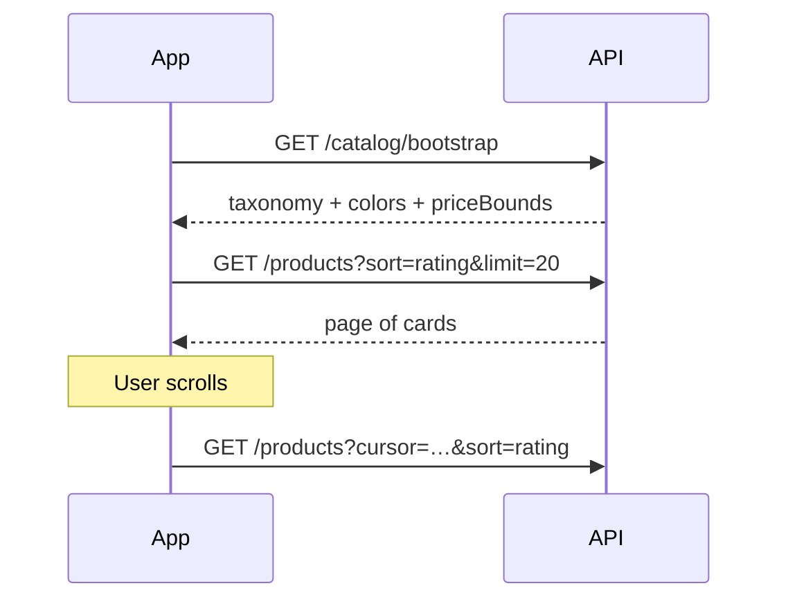
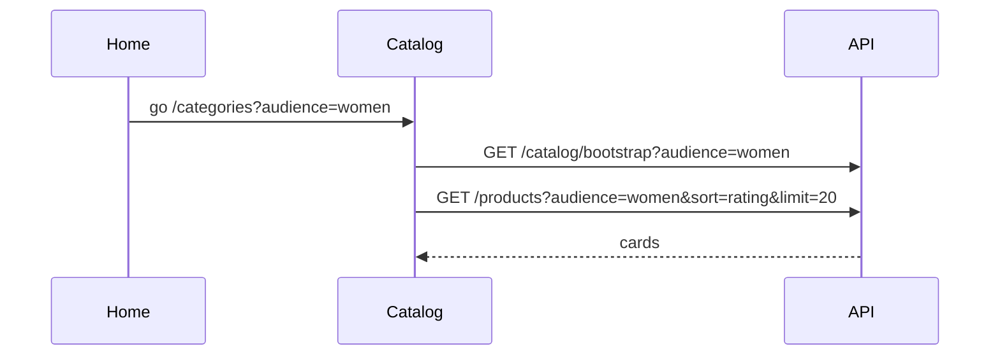
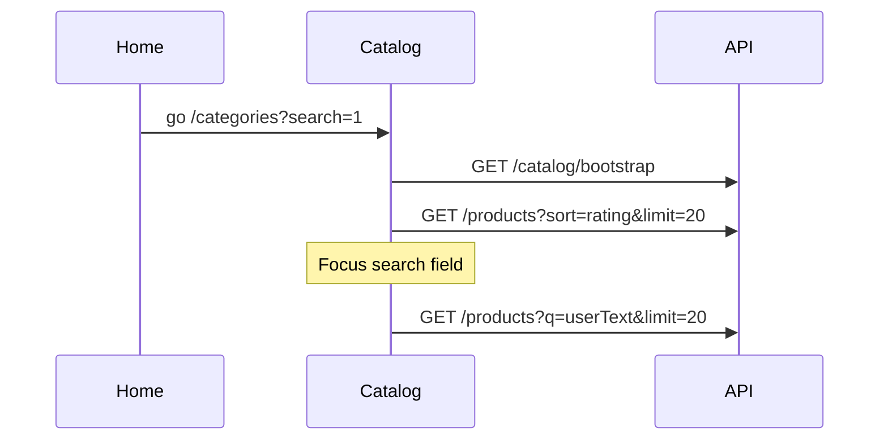
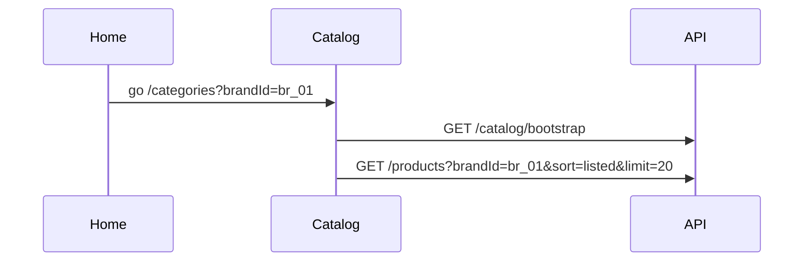
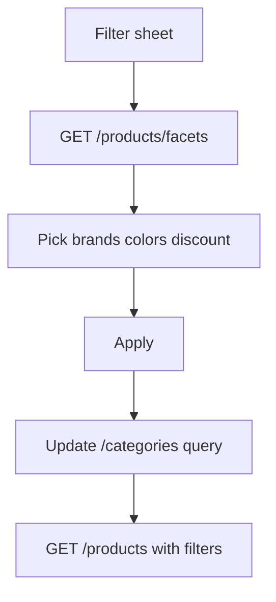

# Redress catalog (Categories tab) API flows

**Version 1.0 — 5 October 2026**

Base URL:

```text
https://redressbackend.cyberimpulses.com/api/v1
```

This document is the Flutter handoff for the shopper **Categories** tab (`/categories` → `CatalogScreen`). Home and Categories are one shopping surface:

- Home **deep-links into** `/categories` with query params
- Categories **loads taxonomy + product list** from APIs
- Product cards match the same shape as `GET /home/feed` rails and `backend-api.md`

Related docs: [`home-screen-flows.md`](./home-screen-flows.md), [`backend-api.md`](./backend-api.md).

Verified against `CatalogScreen` filters and `ShopTaxonomy`:

| UI control | State today | Must map to API |
| --- | --- | --- |
| Audience chips / home Women·Men·Kids | `?audience=` | `audience` |
| Home search icon | `?search=1` | open search UI; list via `q` |
| Home brand tile | (should be) `?brandId=` | `brandId` |
| Home deals / hot offers | `?sort=discount` | `sort=discount` |
| Home try-on see-all | `?tryOn=true` | `tryOn=true` |
| Category sheet | local `ShopTaxonomy` | `GET /categories` |
| Filters: brand, color, min discount | local sets | product query |
| Price range chip | local range | `minPrice` / `maxPrice` |
| Try-on only chip | bool | `tryOn` |
| Sort by discount chip | bool | `sort` |
| Search field | local string | `q` |
| Product grid | `DemoCatalog` | `GET /products` |

---

## Shared rules

```http
Accept: application/json
Accept-Language: it
```

Catalogue browse is **public**. Optional `Authorization: Bearer` enables `wishlisted` on cards.

Success / page / error shapes match the platform contract.

Shop audiences used by the Categories tab:

`women` · `men` · `kids` · `accessories`

(`home` / `beauty` exist in seller taxonomy but are **out of shopper Categories** for this version.)

---

## Home ↔ Categories deep-link contract

Home never invents a second catalogue. Every home `link` with `type: "catalog"` must use path `/categories` and only these query keys so `CatalogScreen` can apply them on open.

### Allowed query keys on `/categories`

| Query | Example | Catalog behavior |
| --- | --- | --- |
| `audience` | `women` | Select audience chip; load taxonomy for that audience |
| `search` | `1` | Expand search field and focus (no `q` yet) |
| `q` | `bianco` | Expand search + prefill + fetch with `q` |
| `brandId` | `br_01` | Apply brand filter (preferred over name) |
| `brand` | `Atelier` | Fallback brand name filter if id missing |
| `categoryId` | `topwear/tshirts` or `tshirts` | Select category chip / sheet |
| `color` | `black` | Multi: repeat or comma `black,navy` |
| `minDiscount` | `30` | Min % off (`10`–`50` steps) |
| `minPrice` | `10` | EUR inclusive |
| `maxPrice` | `80` | EUR inclusive |
| `tryOn` | `true` | Try-on ready only |
| `sort` | `discount` | See sort table below |
| `campaignId` | `cmp_01` | Optional merchandising id (server may expand filters) |

### Home entry examples

| Home UI | Navigate to |
| --- | --- |
| Search bar | `/categories?search=1` |
| Women tile | `/categories?audience=women` |
| Men / Kids | `/categories?audience=men` / `kids` |
| Brand “Tees Deluxe” | `/categories?brandId=br_01` |
| Brands See all | `/categories` (or `/categories` + brands sheet later) |
| Hot offers / Deals See all | `/categories?sort=discount` |
| AI / Trending See all | `/categories?sort=rating` |
| Try-on picks See all | `/categories?tryOn=true` (or `/try-on` when studio) |
| Banner “season sale” | `/categories?sort=discount&minDiscount=30` |

Flutter must:

1. Read URI in `didChangeDependencies` (already reads `audience` + `search`).
2. Extend to apply **all** keys above into local filter state, then call `GET /products`.
3. Keep URI and filter state in sync when the user changes chips (update `context.go` query).

---

## Endpoint index

| # | Method | Path | Auth | Purpose |
| --- | --- | --- | --- | --- |
| 1 | GET | `/catalog/bootstrap` | Public | Taxonomy + filter facets + price bounds for Categories tab |
| 2 | GET | `/categories` | Public | Taxonomy only (also used without bootstrap) |
| 3 | GET | `/products` | Public | Filtered product grid (paginated) |
| 4 | GET | `/products/facets` | Public | Facets for current filters (brands/colors/counts) |
| 5 | GET | `/brands` | Public | Brand directory |
| 6 | GET | `/products/:id` | Public | PDP (from card tap) |

Primary Categories open path:

```text
GET /catalog/bootstrap?audience=women
GET /products?audience=women&limit=20&sort=listed
```

Or, if bootstrap is deferred:

```text
GET /categories?audience=women
GET /products?audience=women&limit=20
```

---

## 1. `GET /catalog/bootstrap`

One call to paint Categories chrome: audience taxonomy, color options, discount steps, price bounds, and optional featured brands for the filter sheet.

### Request

```http
GET /catalog/bootstrap?audience=women
Accept-Language: it
```

| Query | Required | Rule |
| --- | --- | --- |
| `audience` | no | If omitted, return all shopper audiences’ groups (men+women+kids+accessories), matching “no audience selected” sheet |

### Response `200`

```json
{
  "data": {
    "audiences": ["women", "men", "kids", "accessories"],
    "taxonomy": [
      {
        "id": "western",
        "name": "Abbigliamento",
        "items": [
          { "id": "dresses", "name": "Vestiti" },
          { "id": "tops", "name": "Top" },
          { "id": "jeans", "name": "Jeans" }
        ]
      },
      {
        "id": "footwear",
        "name": "Scarpe",
        "items": [
          { "id": "heels", "name": "Tacchi" },
          { "id": "sneakers", "name": "Sneakers" }
        ]
      }
    ],
    "colors": [
      { "id": "black", "name": "Nero", "hex": "#1C1C1C" },
      { "id": "white", "name": "Bianco", "hex": "#F4F4F4" },
      { "id": "navy", "name": "Blu navy", "hex": "#1E3A5F" },
      { "id": "beige", "name": "Beige", "hex": "#D6C4A8" },
      { "id": "grey", "name": "Grigio", "hex": "#9CA3AF" },
      { "id": "green", "name": "Verde", "hex": "#2F8F6B" },
      { "id": "blue", "name": "Blu", "hex": "#3B82F6" }
    ],
    "discountSteps": [10, 20, 30, 40, 50],
    "priceBounds": { "min": 9, "max": 249, "currency": "EUR" },
    "sortOptions": [
      { "id": "listed", "name": "In evidenza" },
      { "id": "rating", "name": "Più votati" },
      { "id": "discount", "name": "Sconto" },
      { "id": "priceLow", "name": "Prezzo ↑" },
      { "id": "priceHigh", "name": "Prezzo ↓" }
    ],
    "brandsPreview": [
      { "id": "br_01", "name": "Tees Deluxe" },
      { "id": "br_02", "name": "Dunko Studio" }
    ]
  }
}
```

| Field | Maps to UI |
| --- | --- |
| `taxonomy` | Category bottom sheet (`ShopTaxonomy` replacement) |
| `colors` | Filter sheet colour chips |
| `discountSteps` | Min-discount chips |
| `priceBounds` | Price range slider min/max |
| `sortOptions` | Sort chip / future sort sheet |
| `brandsPreview` | Initial brand chips; full list via facets or `/brands` |

Names follow `Accept-Language`. Ids stay stable English keys.

### Category id convention

Products store `categoryId` as `group/item` (e.g. `topwear/tshirts`).

| Selection in sheet | Send as `categoryId` |
| --- | --- |
| Whole group “Topwear” | `topwear` |
| Leaf “T-Shirts” | `topwear/tshirts` (preferred) or `tshirts` |

Server match rule (same as app `ShopTaxonomy.matches`):

- exact match, or
- product id starts with `selected/`, or
- selected starts with `productCategory/`

---

## 2. `GET /categories`

Auth: public. Taxonomy only (subset of bootstrap).

### Request

```http
GET /categories?audience=men
```

`audience` required when calling this endpoint alone: `men` \| `women` \| `kids` \| `accessories`.

### Response `200`

```json
{
  "data": [
    {
      "id": "topwear",
      "name": "Parte superiore",
      "items": [
        { "id": "tshirts", "name": "T-shirt" },
        { "id": "shirts", "name": "Camicie" }
      ]
    }
  ]
}
```

Not paginated. Aligns with existing `backend-api.md` and home audience tiles.

---

## 3. `GET /products` (Categories grid)

Auth: public. **This is the main Categories list API.**

### Request query (complete for Categories + Home)

| Query | Example | Catalog UI |
| --- | --- | --- |
| `audience` | `women` | Audience chip |
| `categoryId` | `western/dresses` | Category sheet |
| `brandId` | `br_01` | Brand filter / home brand |
| `brandId` (multi) | `br_01,br_02` | Multi-select brands |
| `brand` | `Atelier` | Name fallback |
| `color` | `black,navy` | Colour chips |
| `minDiscount` | `30` | Discount filter |
| `minPrice` | `10` | Price range start |
| `maxPrice` | `80` | Price range end |
| `tryOn` | `true` | Try-on chip |
| `q` | `felpa` | Search (title, brand, tags, both languages) |
| `sort` | `discount` | Sort chip |
| `campaignId` | `cmp_01` | Optional home campaign |
| `limit` | `20` | Page size (max 50) |
| `cursor` | opaque | Next page |

### Sort values

| `sort` | Behavior | Home / UI |
| --- | --- | --- |
| `listed` | Merchandised / newest live (default) | Default open |
| `rating` | By rating count / score | Trending see-all; default when discount chip off |
| `discount` | Highest % off first | Deals / hot offers / discount chip |
| `priceLow` | Price ascending | Future |
| `priceHigh` | Price descending | Future |

When Categories “Sort by discount” chip is on → `sort=discount`. When off → `sort=rating` (matches current local sort by `ratingCount`).

### Response `200`

```json
{
  "data": [
    {
      "id": "lst_01",
      "brand": "Atelier",
      "brandId": "br_01",
      "title": "Essential Crew Tee",
      "price": 23.2,
      "mrp": 39,
      "audience": "men",
      "categoryId": "topwear/tshirts",
      "color": "white",
      "sizes": ["S", "M", "L"],
      "rating": 4.6,
      "ratingCount": 42,
      "tryOnReady": true,
      "fitReady": true,
      "badge": "Try-On",
      "tags": ["basics"],
      "images": [
        { "url": "https://cdn.example.com/a.jpg", "cover": true, "sort": 0 }
      ],
      "imageUrls": ["https://cdn.example.com/a.jpg"],
      "wishlisted": false,
      "freeShipping": false
    }
  ],
  "page": {
    "limit": 20,
    "nextCursor": "eyJpZCI6ImxzdF8wMiJ9",
    "hasMore": true,
    "total": 128
  }
}
```

Card rules:

- Same object as home rails / `backend-api.md` list card
- Include `brandId` so filters round-trip cleanly
- Client builds discount label from `mrp` / `price`
- Empty result → `{ "data": [], "page": { … "total": 0 } }` → show `catalogSearchEmpty` / clear-filters CTA

### Filter combination

All query filters are **AND**. Multi `color` / `brandId` are **OR within that field**.

Example (home brand + audience + try-on):

```http
GET /products?audience=women&brandId=br_01&tryOn=true&sort=listed&limit=20
```

Example (search from home then typed query):

```http
GET /products?q=giacca&audience=men&sort=rating&limit=20
```

Example (deals from home):

```http
GET /products?sort=discount&minDiscount=30&limit=20
```

---

## 4. `GET /products/facets`

Keeps the filter sheet honest for the **current** audience/category/search (brand list today is derived from demo products).

### Request

Same filter query as `GET /products` **except** omit the facet being listed if needed. Typical:

```http
GET /products/facets?audience=women&categoryId=western/dresses&q=
```

### Response `200`

```json
{
  "data": {
    "brands": [
      { "id": "br_01", "name": "Tees Deluxe", "count": 12 },
      { "id": "br_02", "name": "Dunko Studio", "count": 5 }
    ],
    "colors": [
      { "id": "black", "name": "Nero", "hex": "#1C1C1C", "count": 8 },
      { "id": "beige", "name": "Beige", "hex": "#D6C4A8", "count": 3 }
    ],
    "priceBounds": { "min": 12, "max": 180, "currency": "EUR" },
    "total": 24
  }
}
```

Open filter sheet → call facets with current filters → render brand/color chips with counts. Optional in v1 if bootstrap `brandsPreview` + static colors are enough; required once catalogue is large.

---

## 5. `GET /brands`

Auth: public. Brand directory / “See all brands”.

```http
GET /brands?q=&limit=50
```

Response:

```json
{
  "data": [
    {
      "id": "br_01",
      "name": "Tees Deluxe",
      "tagline": "Essentials",
      "imageUrl": "https://cdn.example.com/brands/tees.jpg"
    }
  ],
  "page": { "limit": 50, "nextCursor": null, "hasMore": false, "total": 6 }
}
```

Home featured brands stay on `/home/feed`; Categories uses this for full browse. Selecting a brand navigates to:

```text
/categories?brandId=br_01
```

then `GET /products?brandId=br_01`.

---

## 6. Screen flows

### A. Open Categories from bottom nav



### B. Open from Home (audience tile)



### C. Open from Home (search)



### D. Open from Home (brand)



### E. Apply filters in sheet



---

## 7. Flutter mapping checklist

| Catalog UI | API |
| --- | --- |
| First open / pull-to-refresh | `GET /catalog/bootstrap` + `GET /products` |
| Change audience chip | Re-bootstrap (or `GET /categories`) + `GET /products?audience=` |
| Category sheet pick | `GET /products?categoryId=` |
| Search typing (debounce ~300ms) | `GET /products?q=` |
| Brand / color / discount apply | `GET /products` (+ optional facets first) |
| Price range apply | `minPrice` + `maxPrice` |
| Try-on chip | `tryOn=true` |
| Sort discount chip on/off | `sort=discount` / `sort=rating` |
| Clear all filters | `GET /products` defaults; clear URI query except shell |
| Infinite scroll | `cursor` from `page.nextCursor` |
| Product tap | `GET /products/:id` |
| Wishlist heart | wishlist APIs; toggle `wishlisted` |

Replace `catalogLoadingProvider` fake delay with real in-flight flags for bootstrap + first products page.

Replace local `ShopTaxonomy` / `DemoCatalog` on this path once wired.

---

## 8. Alignment with `GET /home/feed` links

Home feed `link.query` **must** only use keys from the deep-link table above.

| Home section | Required link.query |
| --- | --- |
| `audiences[]` | `{ "audience": "women" }` |
| `brands[]` | `{ "brandId": "br_01" }` |
| `hotOffers` / deals seeAll | `{ "sort": "discount" }` optionally `minDiscount` |
| `aiPicks` / `trending` seeAll | `{ "sort": "rating" }` |
| `tryOnPicks` seeAll | `{ "tryOn": "true" }` or tryOn route |
| Search | `{ "search": "1" }` |

Do **not** send unknown keys; Catalog should ignore unknown keys safely.

---

## 9. Errors & empty states

| Case | API | Flutter |
| --- | --- | --- |
| Bad `audience` | `400` `VALIDATION` | Fall back to all audiences |
| Unknown `brandId` | `200` empty page | Empty state + clear brand |
| No matches | `200` `data: []` | `catalogSearchEmpty` + clear filters |
| Network | — | Keep last grid; snackbar retry |

---

## 10. Recommended build order

1. Finalize `/categories` query contract (this doc) and update home feed links to emit `brandId` / `sort` / `tryOn` / `audience`.
2. `GET /catalog/bootstrap` from `ShopTaxonomy` + live price bounds.
3. Harden `GET /products` with `brandId`, `minDiscount`, multi `color`, sorts used by Categories.
4. Wire `CatalogScreen` URI → filters → products (drop demo filter pipeline).
5. `GET /products/facets` when brand lists must be dynamic.
6. Pagination + pull-to-refresh.

---

## 11. Notes vs current demo app

| Topic | Demo today | This contract |
| --- | --- | --- |
| Taxonomy | Hardcoded `ShopTaxonomy` | `GET /catalog/bootstrap` / `/categories` |
| Products | `DemoCatalog` client filter | Server `GET /products` |
| Home brand tap | `/categories` only | `/categories?brandId=` |
| Home search | `search=1` only | Same + `q` when typed |
| Brands in filter | Distinct names from demo | Facets / bootstrap ids |
| Price bounds | Computed from demo | `priceBounds` from API |
| Loading | Fake shimmer | Real bootstrap + products |
| Sort | Local discount vs ratingCount | `sort=discount` \| `rating` |
