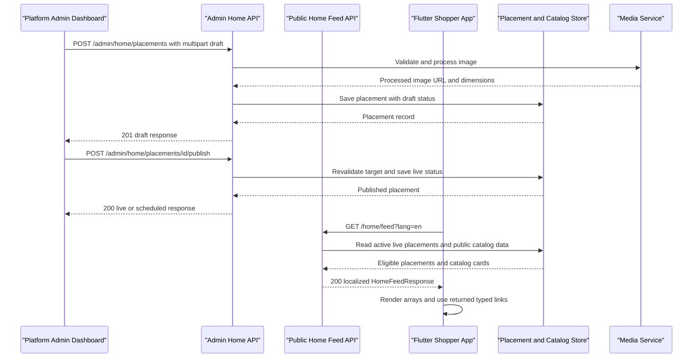

# Redress Home API - Flutter Integration Handoff

**Status:** Implemented API contract | **Last updated:** 7 October 2026 |
**Audience:** Flutter shopper app, Flutter Admin Dashboard, QA, backend

This document describes the shopper Home feed and every Home placement
management endpoint. Shopper Flutter uses the public feed only; an Admin
Dashboard client may use the protected placement endpoints when the signed-in
account has the required permissions.

## 1. Purpose and ownership

Home placements are Redress-curated banners and editorial cards: hero
campaigns, audience tiles, featured brands, lookbooks, promotions, and offers.
Central management lets Redress approve content, schedule campaigns, maintain
safe destinations, and remove outdated content without a mobile release.

The Admin Dashboard saves placements as drafts. An authorized platform admin
explicitly publishes a draft. The public feed then returns only eligible live
content. A seller cannot publish shopper Home content, and the shopper app
cannot create or manage placements.

| Actor | Access |
| --- | --- |
| Shopper / Flutter consumer app | Public, read-only Home feed |
| Super Admin | All Home placement actions |
| Admin/sub-admin | Only Home actions granted to its account role |
| Seller/vendor | No Home placement management access |

The default `admin` role is not automatically granted the Home-content
permissions. The Super Admin role receives platform permissions. Access is
checked on each request; having a valid token alone does not grant permission.

## 2. End-to-end flow

1. The Admin Dashboard creates a placement with its localized copy,
   destination, schedule, sort order, and image. Creation always saves a draft.
2. An admin previews the draft and may edit it.
3. An admin explicitly publishes it. The backend validates the image, copy,
   schedule, section/destination combination, and target eligibility.
4. When its start time arrives, the published placement is eligible for the
   public feed. It is omitted after its end time or when archived, deleted, or
   its destination is no longer public.
5. Flutter requests the localized feed, renders populated sections, and
   navigates only using each returned typed `link`.
6. Admin archives completed content. It remains in admin history but is
   removed from the shopper feed. A draft or archived placement can be deleted
   (soft delete); live content must be archived first.

<!-- mermaid-checked: every participant uses `participant Id as "Label"`, no \n in aliases/messages/notes, every alt/opt/loop closed by end, no `:` inside any alias -->


## 3. Base URL, locale, and response envelope

All paths below are relative to the API base path `/api/v1`. For example:
`GET /api/v1/home/feed?lang=en`.

Every Home endpoint uses the standard JSON envelope:

```json
{
  "success": true,
  "data": {},
  "message": "Operation completed successfully."
}
```

For an error, the response uses `success: false`, `data: null`, and a
human-readable `message`. The server does not return internal error details.
Use the HTTP status code as well as the `success` flag.

The public Home endpoint resolves locale in this order:

1. `lang` query parameter (`en` or `it`);
2. `Accept-Language` header;
3. Italian (`it`) default.

Invalid `lang` query values return `400`. Successful feed responses include
the resolved language in `data.locale` and the `Content-Language` header.

## 4. Public shopper endpoint

### `GET /api/v1/home/feed`

**Purpose:** Load the current Home screen in the requested language.

**Authentication:** None.

**Query:** `lang` (optional; `en` or `it`).

Example:

```http
GET /api/v1/home/feed?lang=en
Accept: application/json
```

### Successful response

The following is a representative response shape. Arrays may be empty, and
`promo` is `{}` when there is no active promotion. Product objects inside
product rails follow the public Catalog product-card contract.

```json
{
  "success": true,
  "data": {
    "generatedAt": "2026-10-07T16:30:00.000Z",
    "locale": "en",
    "meta": {
      "unreadNotifications": 0,
      "wishlistCount": 0,
      "delivery": {
        "addressId": null,
        "city": null,
        "label": null
      }
    },
    "banners": [
      {
        "id": "101",
        "title": "Autumn edit",
        "subtitle": "Selected styles for the season",
        "ctaLabel": "Shop now",
        "imageUrl": "https://api.example/api/v1/media/opaque-token",
        "alt": "Autumn looks",
        "sortOrder": 1,
        "type": "product",
        "link": {
          "type": "product",
          "path": "/product/41",
          "query": {
            "productId": "41"
          }
        },
        "product": {
          "id": "41",
          "brand": "ModaViva",
          "brandId": "5",
          "title": "Floral Midi Dress",
          "price": 69.9,
          "mrp": 79.9,
          "currency": "EUR",
          "imageUrls": [
            "https://api.example/api/v1/media/product-image-token"
          ],
          "badge": "Editorial"
        },
        "offer": null,
        "brand": null,
        "badge": null,
        "discountLabel": null
      }
    ],
    "audiences": [
      {
        "id": "1",
        "label": "Women",
        "imageUrl": null,
        "audience": "women",
        "link": {
          "type": "catalog",
          "path": "/categories",
          "query": {
            "audience": "women"
          }
        }
      }
    ],
    "brands": [
      {
        "id": "5",
        "name": "ModaViva",
        "tagline": null,
        "imageUrl": "https://api.example/api/v1/media/brand-image-token",
        "link": {
          "type": "brand",
          "path": "/categories",
          "query": {
            "brandId": "5"
          }
        }
      }
    ],
    "studio": {
      "title": "Style Studio",
      "subtitle": "Try looks with AI and find your perfect fit",
      "ctaLabel": "Generate look",
      "link": {
        "type": "tryOn",
        "path": "/try-on",
        "query": {}
      }
    },
    "promo": {},
    "lookbook": [],
    "aiPicks": {
      "title": "AI picks for you",
      "subtitle": "Selected from styles shoppers love",
      "seeAll": {
        "type": "catalog",
        "path": "/categories",
        "query": {
          "sort": "featured"
        }
      },
      "items": []
    },
    "hotOffers": {
      "title": "Hot offers",
      "seeAll": {
        "type": "catalog",
        "path": "/categories",
        "query": {
          "sort": "discount"
        }
      },
      "items": []
    },
    "deals": {
      "title": "Top deals",
      "seeAll": {
        "type": "catalog",
        "path": "/categories",
        "query": {
          "sort": "discount",
          "minDiscount": 30
        }
      },
      "items": []
    },
    "tryOnPicks": {
      "title": "Ready for try-on",
      "seeAll": {
        "type": "catalog",
        "path": "/categories",
        "query": {}
      },
      "items": []
    },
    "trending": {
      "title": "Trending",
      "seeAll": {
        "type": "catalog",
        "path": "/categories",
        "query": {
          "sort": "newest"
        }
      },
      "items": []
    }
  },
  "message": "Home feed retrieved successfully."
}
```

### Feed fields and rendering behavior

| Field | Shape and purpose | Flutter behavior |
| --- | --- | --- |
| `generatedAt` | ISO-8601 generation time | Informational; not a content ID |
| `locale` | `en` or `it` | Use as the active feed locale |
| `meta` | Notification, wishlist, and delivery values | Currently safe defaults; do not infer personalization |
| `banners` | Ordered editorial cards for the `hero` section | Hide when empty; render in returned order |
| `audiences` | Women, Men, Kids category tiles | Hide when empty; image may be `null` |
| `brands` | Brand cards; includes active catalog brands and curated placements | Hide when empty; maximum six |
| `studio` | Static Style Studio card | Use the returned link; this is not a CMS placement |
| `promo` | One promotion card or `{}` | Hide when empty |
| `lookbook` | Ordered editorial cards | Hide when empty |
| `aiPicks` | Rail with catalog product-card `items` | Hide if `items` is empty |
| `hotOffers` | Rail with editorial placement-card `items` | Hide if `items` is empty |
| `deals` | Rail with catalog product-card `items` | Hide if `items` is empty |
| `tryOnPicks` | Rail with catalog product-card `items` | May be empty in production |
| `trending` | Rail with catalog product-card `items` | May be empty in production |

`banners`, `lookbook`, and `hotOffers.items` contain editorial placement
cards. A `promo` object, when populated, selects the corresponding fields
from one promotion card. Home placement card fields include `id`, localized
`title`, `subtitle`, `ctaLabel`, `imageUrl`, `alt`, `sortOrder`, `type`,
`link`, `product`, `offer`, `brand`, `badge`, and `discountLabel`.
`product`, `offer`, or `brand` may be `null` when not applicable.

The feed's `imageUrl` and image URLs nested in cards are server-proxied media
URLs. They are not durable asset identifiers. Use them in network image
widgets; do not derive an image URL from an admin storage key or assume the URL
will be permanent. The public card does not include admin image dimensions.

### Navigation rules

Use the returned `link` object as the source of truth; do not build links from
campaign copy or placement IDs.

| `link.type` | Meaning | Flutter behavior |
| --- | --- | --- |
| `product` | Product destination | Open the product detail flow using `link.path` and `link.query`; use `product` only as a preview summary |
| `brand` | Brand destination | Open Categories with the returned `brandId` query |
| `catalog` | Category or filtered catalog destination | Open Categories with the returned allow-listed filters |
| `tryOn` | Style Studio destination | Use the returned `path` |
| `offer`, `route`, `external` | Legacy feed types | Do not add new handling without an approved contract change |

Admin CMS Phase 1 can author `product`, `brand`, `category`, and `catalog`
targets only. A category target is presented to Flutter as a `catalog` link.
Admin cannot create arbitrary client routes, URLs, or mobile paths.

### Public endpoint errors

| HTTP status | Meaning | Response example |
| --- | --- | --- |
| `400` | Invalid query parameter (including unsupported `lang`) | `{"success":false,"data":null,"message":"The request parameters are invalid. Use lang=en or lang=it."}` |
| `500` | Unexpected feed failure | `{"success":false,"data":null,"message":"An unexpected error occurred. Please try again later."}` |

Successful feed responses may be cached for 60 seconds and served stale for
up to 300 seconds while revalidating. After an admin publishes or archives
content, Flutter may not see the change until its next refresh/cache window.

## 5. Admin Home placement endpoints

These routes are for an authenticated Admin Dashboard client, not the shopper
Home screen. All require an `Authorization` header with the admin bearer
access token. Send `Accept: application/json`.

No endpoint accepts a client-supplied storage key or arbitrary navigation
path. IDs in JSON responses are strings; path IDs and numeric form fields are
sent as strings in URLs or multipart form data.

### Endpoint overview

| Method and path | Permission | Purpose | Success |
| --- | --- | --- | --- |
| `GET /api/v1/admin/home/placements` | `platform.home_content.view` | List and filter placements | `200` list and pagination |
| `POST /api/v1/admin/home/placements` | `platform.home_content.create` | Upload creative and create a draft | `201` placement |
| `GET /api/v1/admin/home/placements/{id}` | `platform.home_content.view` | Read one placement for preview/edit | `200` placement |
| `PATCH /api/v1/admin/home/placements/{id}` | `platform.home_content.update` | Edit a draft or live placement | `200` updated placement |
| `POST /api/v1/admin/home/placements/{id}/publish` | `platform.home_content.publish` | Publish a draft now or schedule it | `200` live/scheduled placement |
| `POST /api/v1/admin/home/placements/{id}/archive` | `platform.home_content.publish` | Retire a placement and remove it from feed | `200` archived placement |
| `DELETE /api/v1/admin/home/placements/{id}` | `platform.home_content.delete` | Soft-delete a draft or archived placement | `200` with `data: null` |

### `GET /api/v1/admin/home/placements`

Returns a paginated admin list. Only records created by the Home Admin CMS are
listed. Optional query parameters:

| Parameter | Meaning | Allowed values/default |
| --- | --- | --- |
| `page` | 1-based page | Integer >= 1; default `1` |
| `limit` | Page size | Integer `1`-`100`; default `20` |
| `sectionKey` | Filter by Home section | `hero`, `audience`, `top_brand`, `lookbook`, `promotion`, `offer` |
| `status` | Filter by display status | `draft`, `live`, `scheduled`, `expired`, `archived` |
| `startsBefore` | Include start dates at or before this ISO-8601 date-time | Optional |
| `endsAfter` | Include end dates at or after this ISO-8601 date-time | Optional |

Example:

```http
GET /api/v1/admin/home/placements?page=1&limit=20&sectionKey=hero&status=scheduled
```

Response data shape:

```json
{
  "success": true,
  "data": {
    "items": [],
    "pagination": {
      "page": 1,
      "limit": 20,
      "total": 0,
      "totalPages": 0
    }
  },
  "message": "Home placements retrieved successfully."
}
```

### `POST /api/v1/admin/home/placements`

Creates a draft. This endpoint never publishes content.

**Content type:** `multipart/form-data`

**Required permission:** `platform.home_content.create`

**Required fields:** `sectionKey`, `targetType`, the corresponding target
field, and `image`.

Example form fields for a hero banner linking to product `41`:

```text
sectionKey=hero
targetType=product
targetProductId=41
titleEn=Autumn edit
titleIt=Selezione autunnale
subtitleEn=Selected styles for the season
subtitleIt=Stili scelti per la stagione
ctaLabelEn=Shop now
ctaLabelIt=Acquista ora
altTextEn=Autumn looks
altTextIt=Look autunnali
sortOrder=10
startsAt=2026-10-08T00:00:00.000Z
endsAt=2026-10-31T23:59:59.000Z
image=<JPEG, PNG, or WebP file>
```

`targetFilters` is a JSON-encoded string when sent as multipart data, for
example:

```text
targetType=catalog
targetFilters={"category":"women-dresses","sort":"newest"}
```

Send only the one destination field that matches `targetType`:

| `targetType` | Required field |
| --- | --- |
| `product` | `targetProductId` |
| `brand` | `targetBrandId` |
| `category` | `targetCategoryId` |
| `catalog` | `targetFilters` |

Accepted content fields: `titleEn`, `titleIt`, `subtitleEn`, `subtitleIt`,
`ctaLabelEn`, `ctaLabelIt`, `altTextEn`, `altTextIt`, `badgeEn`, `badgeIt`,
`discountLabelEn`, `discountLabelIt`, `startsAt`, `endsAt`, and `sortOrder`.
Text may be omitted when optional for the selected section; Hero requires
English and Italian title, subtitle, CTA label, and alt text at publish time.
All sections require English and Italian alt text at publish time. Audience
also requires a title in both languages.

The backend accepts JPEG, PNG, and WebP uploads, processes the image to WebP,
and enforces section dimensions and aspect ratio. `targetFilters` may use only
the supported catalog filters: `category`, `brand`, `color`, `size`, `fit`,
`minPrice`, `maxPrice`, `featured`, `inStock`, and `sort`.

Success is `201 Created`, with the common envelope and a placement DTO in
`data`. The returned placement has `status: "draft"` and `storedStatus:
"draft"`.

### `GET /api/v1/admin/home/placements/{id}`

Returns the placement DTO for admin preview/edit. `id` must be a positive
integer. Success is `200 OK`.

### `PATCH /api/v1/admin/home/placements/{id}`

Updates a draft or live placement; send `multipart/form-data` even when only
text fields change. All fields are optional, but at least one field must be
provided. Image is optional; omitting it retains the existing image. An empty
text value clears an optional text field.

When changing `targetType`, provide the complete matching destination field;
only one destination field is allowed. A live placement stays live only if
the updated content passes the publication checks. Archived placements cannot
be edited; create a replacement draft instead. Success is `200 OK` with the
updated placement DTO.

### `POST /api/v1/admin/home/placements/{id}/publish`

Publishes a draft, or schedules it if its `startsAt` is in the future.
Publishing has no request body. The backend checks that:

- the placement is a draft;
- an image meets the section's minimum dimensions and ratio;
- required English and Italian copy is present;
- start/end dates are valid and the end is later than the start;
- the section allows the selected destination type; and
- the product, brand, category, or catalog filters are still eligible.

Success is `200 OK`. The DTO has `storedStatus: "live"`; its effective `status`
is `scheduled` until the start time, then `live`, and later `expired` after
the end time.

### `POST /api/v1/admin/home/placements/{id}/archive`

Immediately removes the placement from the public Home feed and retains the
record for admin history. No request body is required. Success is `200 OK`
with `status` and `storedStatus` set to `archived`.

### `DELETE /api/v1/admin/home/placements/{id}`

Soft-deletes a placement. Only drafts and archived placements can be deleted;
archive a live placement first. Success is:

```json
{
  "success": true,
  "data": null,
  "message": "Home placement deleted successfully."
}
```

## 6. Admin placement response DTO

The create, get, update, publish, and archive endpoints return this shape under
`data`; list items use the same shape.

```json
{
  "id": "101",
  "sectionKey": "hero",
  "status": "scheduled",
  "storedStatus": "live",
  "target": {
    "type": "product",
    "productId": "41",
    "brandId": null,
    "categoryId": null,
    "filters": null
  },
  "content": {
    "titleEn": "Autumn edit",
    "titleIt": "Selezione autunnale",
    "subtitleEn": "Selected styles for the season",
    "subtitleIt": "Stili scelti per la stagione",
    "ctaLabelEn": "Shop now",
    "ctaLabelIt": "Acquista ora",
    "altTextEn": "Autumn looks",
    "altTextIt": "Look autunnali",
    "badgeEn": null,
    "badgeIt": null,
    "discountLabelEn": null,
    "discountLabelIt": null
  },
  "image": {
    "url": "https://api.example/api/v1/media/opaque-token",
    "width": 1600,
    "height": 900,
    "contentType": "image/webp",
    "sizeBytes": 185000
  },
  "schedule": {
    "startsAt": "2026-10-08T00:00:00.000Z",
    "endsAt": "2026-10-31T23:59:59.000Z"
  },
  "sortOrder": 10,
  "audit": {
    "createdAt": "2026-10-07T16:00:00.000Z",
    "updatedAt": "2026-10-07T16:10:00.000Z",
    "publishedAt": "2026-10-07T16:10:00.000Z",
    "createdByAccountId": "7",
    "updatedByAccountId": "7",
    "publishedByAccountId": "7"
  }
}
```

`status` is the calculated admin display state (`draft`, `live`, `scheduled`,
`expired`, or `archived`). `storedStatus` is the persisted lifecycle state
(`draft`, `live`, or `archived`). Admin `image.url` is a media URL; never send
its storage key back to the API.

### Section and destination combinations

| `sectionKey` | Allowed `targetType` values | Expected image ratio and minimum dimensions |
| --- | --- | --- |
| `hero` | `product`, `catalog` | 16:9; 1440 x 810 |
| `audience` | `category`, `catalog` | 3:4; 900 x 1200 |
| `top_brand` | `brand` | 1:1; 800 x 800 |
| `lookbook` | `product`, `brand`, `catalog` | 4:5; 1080 x 1350 |
| `promotion` | `product`, `catalog` | 16:9; 1440 x 810 |
| `offer` | `product`, `brand`, `category`, `catalog` | 3:4; 900 x 1200 |

## 7. Admin API error responses

Admin routes require both an active authenticated session and the specific
permission shown above. Expected error envelope:

```json
{
  "success": false,
  "data": null,
  "message": "You do not have permission to perform this action."
}
```

| HTTP status | Meaning |
| --- | --- |
| `400` | Invalid query parameter or placement identifier |
| `401` | Missing, invalid, expired, or inactive authenticated session |
| `403` | Authenticated account lacks the route's permission |
| `404` | Placement ID does not exist |
| `409` | Invalid lifecycle transition (for example, publish non-draft, edit archived, or delete live) |
| `413` | Uploaded image exceeds the configured upload size |
| `422` | Invalid placement fields, schedule, target, or image |
| `500` | Unexpected server error |

Messages are safe for display. Do not expect a machine-specific exception,
internal permission details, or stack trace in the response.

## 8. Flutter integration guidance

- Shopper Home calls only `GET /api/v1/home/feed`; it must never call an Admin
  placement endpoint.
- Keep the last successful feed visible during refresh. Show initial loading
  only when no feed has been loaded; show a retry state on failure.
- Empty arrays and `promo: {}` are successful results, not errors. Hide those
  sections rather than drawing fake marketing cards.
- Keep server ordering (`sortOrder`) for editorial sections.
- Treat feed models as forward-compatible: tolerate nullable images and
  nullable editorial sub-objects.
- Use the returned typed `link`; do not construct routes from content text.
- Feed `imageUrl` values can change or expire. Refresh the feed when an image
  URL becomes unavailable rather than persisting the URL indefinitely.
- Do not expect draft/admin `status`, `schedule`, audit data, target IDs, or
  storage keys in the public feed.
- Treat `meta` notification, wishlist, and delivery values as placeholders
  until their own authenticated contracts are implemented.
- `tryOnPicks` and `trending` are not backed by persisted eligibility/popularity
  data and may be empty in production.

## 9. Verification checklist

1. Call the public feed without a token and with each supported `lang`.
2. Confirm invalid locale values return `400` using the standard envelope.
3. Verify empty placement arrays render as hidden sections without an error.
4. For Admin client verification, confirm unauthenticated calls return `401`
   and accounts lacking the specific permission return `403`.
5. Create a draft, confirm it is absent from the public feed, publish it, and
   confirm it appears only in its expected section and active time window.
6. Verify product/brand/category/catalog links open the expected destination.
7. Archive the placement and confirm it disappears on the next feed refresh.
   The feed response requires revalidation, so a published change is not
   intentionally served from a stale Home-feed cache.
8. Verify a live placement cannot be deleted until it is archived.

## 10. Canonical references

- Public Home response implementation: `src/modules/home/home.service.js`
- Public Home route/controller: `src/modules/home/home.routes.js` and
  `src/modules/home/home.controller.js`
- Admin Home API: `src/modules/admin-home/`
- OpenAPI specification: `src/docs/openapi/openapi.json`
- Content lifecycle and editorial rules: `docs/home-content-management-flow.md`
