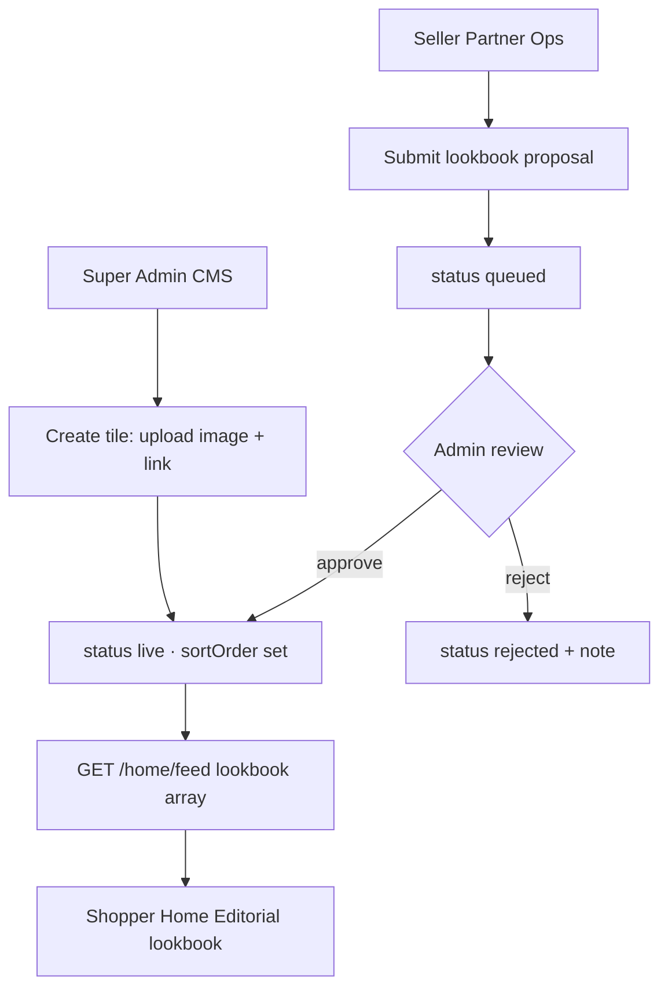
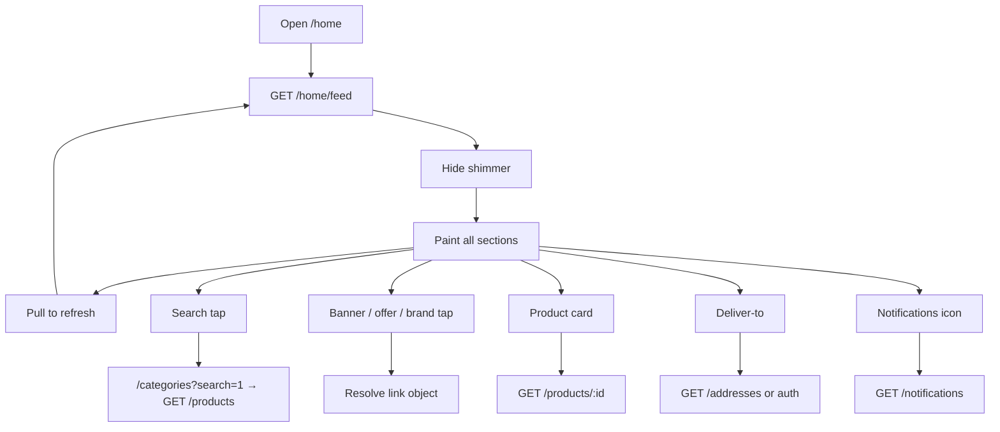

 # Redress home screen API flows

**Version 1.0 — 5 October 2026**

Base URL:

```text
https://redressbackend.cyberimpulses.com/api/v1
```

This document is the Flutter handoff contract for the shopper **Home** tab (`/home` → `HomeScreen`). It replaces local demo sources (`DemoCatalog`, `DemoBrands`, `HomeMarketing`, fake `homeLoadingProvider`) with production APIs.

It complements:

| Document | Scope |
| --- | --- |
| `auth-flows.md` | Login / session |
| `shopper-account-flows.md` | Addresses, body profiles, interests, support |
| `catalog-screen-flows.md` | **Categories tab** — taxonomy, filters, `GET /products`, Home deep links |
| `backend-api.md` | Shop catalogue, cart, orders (product card shape reused here) |

Verified against the current home layout (top → bottom):

1. App bar (logo, deliver-to, notifications, wishlist)
2. Search
3. Sale banner carousel
4. Shop-by audience tiles (Women / Men / Kids)
5. Brands rail
6. Style Studio card
7. Promo spotlight (AI Fit)
8. Lookbook
9. AI picks product rail
10. Hot offers vertical rail
11. Top deals product rail
12. Try-on picks product rail
13. Trending zigzag grid

---

## Design approach

### One feed for first paint

Home should load with **one primary call** so Flutter can drop shimmer after a single response:

```http
GET /home/feed
```

That response returns every curated section in screen order. Product rails use the same **product card** object as `GET /products` (not full PDP).

### Secondary calls for chrome + “See all”

| Need | API |
| --- | --- |
| Deliver-to city | `GET /addresses` (JWT) — already in account flows |
| Notification badge | `GET /notifications?limit=1` or unread count — see below |
| Wishlist badge | `GET /wishlist` page `total`, or include count in feed meta |
| Search / See all / audience / brand / deals | Navigate to `/categories?…` then Categories APIs in [`catalog-screen-flows.md`](./catalog-screen-flows.md) |
| Pull-to-refresh | Re-call `GET /home/feed` |

### Auth model

| Call | Auth |
| --- | --- |
| `GET /home/feed` | **Public** (guest OK). Optional Bearer personalizes AI picks |
| Product / brand / category browse | Public |
| Addresses / wishlist mutations / notifications | JWT |

When JWT is present, send it on `/home/feed` so `aiPicks` and optional `deliveryHint` can personalize. Without JWT, return generic curated rails.

---

## Shared rules

```http
Accept: application/json
Accept-Language: it
Authorization: Bearer <accessToken>   # optional on /home/feed
```

Success:

```json
{ "data": {} }
```

Errors match the platform contract (`VALIDATION`, `SESSION_EXPIRED`, `SESSION_CLOSED`, …).

Currency is EUR. Times are ISO-8601 UTC. Marketing copy follows `Accept-Language`. Product titles/brands stay in the seller’s language (not machine-translated).

---

## Endpoint index

| # | Method | Path | Auth | Purpose |
| --- | --- | --- | --- | --- |
| 1 | GET | `/home/feed` | Public + optional JWT | Full home payload for first paint / refresh |
| 2 | GET | `/home/sections/:key` | Public + optional JWT | One section only (optional, for lazy refresh) |
| 3 | GET | `/products` | Public | See-all / search / brand / deals / try-on filters |
| 4 | GET | `/brands` | Public | Brand directory (home rail uses feed; see-all uses this) |
| 5 | GET | `/categories` | Public | Taxonomy (shop-by uses feed tiles; catalog uses this) |
| 6 | GET | `/notifications/unread-count` | JWT | App-bar badge |
| 7 | GET | `/wishlist` | JWT | Badge `page.total` (or dedicated count) |
| 8 | GET | `/addresses` | JWT | Deliver-to city / default address |

Items 3–5 and 8 already exist (or are specified) elsewhere. This document defines **1, 2, 6** and how home consumes the rest.

---

## 1. Product card (shared)

Used in AI picks, deals, try-on picks, trending. Same shape as shop list cards in `backend-api.md`.

```json
{
  "id": "lst_01",
  "brand": "Atelier",
  "title": "Essential Crew Tee",
  "price": 23.2,
  "mrp": 39,
  "audience": "men",
  "categoryId": "topwear/tshirts",
  "color": "white",
  "sizes": ["S", "M", "L"],
  "rating": 4.6,
  "ratingCount": 42,
  "tryOnReady": true,
  "fitReady": true,
  "badge": "Try-On",
  "tags": ["basics"],
  "images": [
    { "url": "https://cdn.example.com/a.jpg", "cover": true, "sort": 0 }
  ],
  "imageUrls": ["https://cdn.example.com/a.jpg"],
  "wishlisted": false,
  "freeShipping": false
}
```

| Extra for home | Rule |
| --- | --- |
| `wishlisted` | Present when Bearer is sent; otherwise omit or `false` |
| Client discount label | Derive from `mrp` and `price` (same as demo `discountPercent`) |

Tap → `/product/:id`. Rating tap → `/product/:id/reviews`.

---

## 2. Deep link target (fixed types)

Home marketing tiles (lookbook, banners, hot offers, promo) always use a **fixed `type`**. Flutter switches only on that enum — never invents types client-side.

### Allowed `type` values

| `type` | Meaning | Flutter redirect | Extra payload on tile |
| --- | --- | --- | --- |
| `product` | Editorial product | `/product/{productId}` | `product` card summary |
| `offer` | Editorial offer / campaign | `/categories?campaignId=…` (or offer landing) | `offer` summary |
| `brand` | Brand shop | `/categories?brandId=…` | `brand` summary |
| `tryOn` | Style Studio | `/try-on` (+ optional product) | optional `product` |
| `catalog` | Generic category filters | `/categories?…` | none (query only) |
| `route` | Other in-app path | e.g. `/plans` | none |
| `external` | HTTPS URL | browser | none |

`brand` is preferred over `catalog` + `brandId` when the tile is clearly a brand story. `catalog` stays for audience / sort-only links.

### Tile envelope (every image)

```json
{
  "id": "lk_01",
  "imageUrl": "https://cdn.example.com/lookbook/1.jpg",
  "alt": "Spring denim",
  "sortOrder": 1,
  "type": "product",
  "link": {
    "type": "product",
    "path": "/product/lst_88",
    "query": { "productId": "lst_88" }
  },
  "product": null,
  "offer": null,
  "brand": null
}
```

Rules:

- `type` and `link.type` **must match**.
- Exactly one of `product` / `offer` / `brand` is filled for that type; others are `null`.
- `tryOn` may include `product` when the try-on should open with a garment.
- `imageUrl` is the editorial creative (may differ from product cover).

### Examples by type

**Product** — image + product details in the same feed item:

```json
{
  "id": "lk_01",
  "imageUrl": "https://cdn.example.com/editorial/denim-story.jpg",
  "type": "product",
  "link": {
    "type": "product",
    "path": "/product/lst_88",
    "query": { "productId": "lst_88" }
  },
  "product": {
    "id": "lst_88",
    "brand": "Friday Edit",
    "brandId": "br_03",
    "title": "Relaxed Denim Jacket",
    "price": 79,
    "mrp": 99,
    "imageUrls": ["https://cdn.example.com/products/lst_88_cover.jpg"],
    "tryOnReady": true,
    "badge": "Editorial"
  },
  "offer": null,
  "brand": null
}
```

Tap → PDP. Optional UI: price chip on the lookbook tile using `product.price` (no second API call).

**Offer** — image + offer data:

```json
{
  "id": "lk_02",
  "imageUrl": "https://cdn.example.com/editorial/flash-sale.jpg",
  "type": "offer",
  "link": {
    "type": "offer",
    "path": "/categories",
    "query": { "campaignId": "cmp_12", "sort": "discount" }
  },
  "product": null,
  "offer": {
    "id": "cmp_12",
    "title": "Weekend 30% off",
    "badge": "30% OFF",
    "sellerId": "sel_01",
    "sellerName": "Atelier",
    "startsAt": "2026-10-04T00:00:00.000Z",
    "endsAt": "2026-10-06T23:59:59.000Z",
    "minDiscount": 30
  },
  "brand": null
}
```

Tap → Categories filtered by that campaign/offer.

**Brand**:

```json
{
  "id": "lk_03",
  "imageUrl": "https://cdn.example.com/editorial/tees-deluxe.jpg",
  "type": "brand",
  "link": {
    "type": "brand",
    "path": "/categories",
    "query": { "brandId": "br_01" }
  },
  "product": null,
  "offer": null,
  "brand": {
    "id": "br_01",
    "name": "Tees Deluxe",
    "tagline": "Essentials",
    "imageUrl": "https://cdn.example.com/brands/tees.jpg"
  }
}
```

**Try-on**:

```json
{
  "id": "lk_04",
  "imageUrl": "https://cdn.example.com/editorial/studio.jpg",
  "type": "tryOn",
  "link": {
    "type": "tryOn",
    "path": "/try-on",
    "query": { "productId": "lst_88" }
  },
  "product": {
    "id": "lst_88",
    "title": "Relaxed Denim Jacket",
    "imageUrls": ["https://cdn.example.com/products/lst_88_cover.jpg"],
    "tryOnReady": true
  },
  "offer": null,
  "brand": null
}
```

### Flutter redirect (one helper)

```text
switch (tile.type) {
  product → push /product/{product.id}
  offer   → go /categories?campaignId={offer.id}&sort=discount
  brand   → go /categories?brandId={brand.id}
  tryOn   → go /try-on[?productId=]
  catalog → go /categories?{link.query}
}
```

Backend sends **image + typed details together** in `/home/feed`. Flutter does **not** need a second call just to know where to redirect. Full PDP still loads via `GET /products/:id` only after the user opens the product screen.

| Home section | Typical `query` / type |
| --- | --- |
| Search bar | `catalog` + `{ "search": "1" }` |
| Audience tile | `catalog` + `{ "audience": "women" }` |
| Brand tile / lookbook brand | `brand` + `brand` object |
| Hot offers / lookbook offer | `offer` + `offer` object |
| Lookbook product | `product` + `product` object |
| Promo / studio / lookbook try-on | `tryOn` |

---

## 3. `GET /home/feed`

### Request

```http
GET /home/feed
Accept-Language: it
Authorization: Bearer <accessToken>   # optional
```

Optional query:

| Query | Default | Meaning |
| --- | --- | --- |
| `limitPerRail` | `8` | Max products per rail (Flutter currently shows 4–6) |
| `include` | all | Comma list to omit heavy rails if needed later |

### Response `200`

```json
{
  "data": {
    "generatedAt": "2026-10-05T09:00:00.000Z",
    "locale": "it",
    "meta": {
      "unreadNotifications": 0,
      "wishlistCount": 0,
      "delivery": {
        "addressId": null,
        "city": null,
        "label": null
      }
    },
    "banners": [],
    "audiences": [],
    "brands": [],
    "studio": {},
    "promo": {},
    "lookbook": [],
    "aiPicks": { "title": "", "subtitle": "", "seeAll": {}, "items": [] },
    "hotOffers": { "title": "", "seeAll": {}, "items": [] },
    "deals": { "title": "", "seeAll": {}, "items": [] },
    "tryOnPicks": { "title": "", "seeAll": {}, "items": [] },
    "trending": { "title": "", "seeAll": {}, "items": [] }
  }
}
```

When guest (no JWT):

- `meta.unreadNotifications` = `0`
- `meta.wishlistCount` = `0`
- `meta.delivery` all null → Flutter may hide city or show “Add address” after login
- `aiPicks` = editorial defaults (not body-profile based)
- `wishlisted` on cards = `false` / omitted

When JWT present:

- Fill `meta` from that user
- Prefer default address city for `meta.delivery`
- Personalize `aiPicks` using shopper interests + default body profile when available

### Full example

```json
{
  "data": {
    "generatedAt": "2026-10-05T09:00:00.000Z",
    "locale": "it",
    "meta": {
      "unreadNotifications": 3,
      "wishlistCount": 2,
      "delivery": {
        "addressId": "adr_01",
        "city": "Milano",
        "label": "Home"
      }
    },
    "banners": [
      {
        "id": "bn_01",
        "imageUrl": "https://cdn.example.com/home/banner1.jpg",
        "title": "Saldi di stagione",
        "subtitle": "Fino al 50% sui nuovi arrivi",
        "ctaLabel": "Acquista ora",
        "link": {
          "type": "catalog",
          "path": "/categories",
          "query": { "sort": "discount" }
        },
        "sortOrder": 1
      }
    ],
    "audiences": [
      {
        "id": "women",
        "label": "Donna",
        "imageUrl": "https://cdn.example.com/home/cat-women.jpg",
        "audience": "women",
        "link": {
          "type": "catalog",
          "path": "/categories",
          "query": { "audience": "women" }
        }
      },
      {
        "id": "men",
        "label": "Uomo",
        "imageUrl": "https://cdn.example.com/home/cat-men.jpg",
        "audience": "men",
        "link": {
          "type": "catalog",
          "path": "/categories",
          "query": { "audience": "men" }
        }
      },
      {
        "id": "kids",
        "label": "Bambini",
        "imageUrl": "https://cdn.example.com/home/cat-kids.jpg",
        "audience": "kids",
        "link": {
          "type": "catalog",
          "path": "/categories",
          "query": { "audience": "kids" }
        }
      }
    ],
    "brands": [
      {
        "id": "br_01",
        "name": "Tees Deluxe",
        "tagline": "Essentials",
        "imageUrl": "https://cdn.example.com/brands/tees-deluxe.jpg",
        "link": {
          "type": "catalog",
          "path": "/categories",
          "query": { "brandId": "br_01" }
        }
      }
    ],
    "studio": {
      "title": "Style Studio",
      "subtitle": "Prova i look con l’AI e trova la taglia giusta",
      "ctaLabel": "Genera look",
      "link": { "type": "tryOn", "path": "/try-on", "query": {} }
    },
    "promo": {
      "id": "promo_ai_fit",
      "badge": "AI Fit",
      "title": "La tua taglia, senza indovinare",
      "subtitle": "Usa il profilo corpo e lo Style Studio",
      "imageUrl": "https://cdn.example.com/home/promo-ai.jpg",
      "discountLabel": "10% OFF",
      "ctaLabel": "Acquista ora",
      "link": { "type": "tryOn", "path": "/try-on", "query": {} }
    },
    "lookbook": [
      {
        "id": "lk_01",
        "imageUrl": "https://cdn.example.com/lookbook/1.jpg",
        "link": { "type": "tryOn", "path": "/try-on", "query": {} }
      }
    ],
    "aiPicks": {
      "title": "Scelte AI per te",
      "subtitle": "Dal tuo gusto e dal profilo corpo",
      "seeAll": {
        "type": "catalog",
        "path": "/categories",
        "query": { "sort": "rating" }
      },
      "items": [
        {
          "id": "lst_01",
          "brand": "Atelier",
          "title": "Essential Crew Tee",
          "price": 23.2,
          "mrp": 39,
          "audience": "men",
          "categoryId": "topwear/tshirts",
          "color": "white",
          "sizes": ["S", "M", "L"],
          "rating": 4.6,
          "ratingCount": 42,
          "tryOnReady": true,
          "fitReady": true,
          "badge": "AI",
          "tags": ["basics"],
          "images": [
            { "url": "https://cdn.example.com/a.jpg", "cover": true, "sort": 0 }
          ],
          "imageUrls": ["https://cdn.example.com/a.jpg"],
          "wishlisted": true,
          "freeShipping": false
        }
      ]
    },
    "hotOffers": {
      "title": "Offerte del momento",
      "seeAll": {
        "type": "catalog",
        "path": "/categories",
        "query": { "sort": "discount" }
      },
      "items": [
        {
          "id": "off_01",
          "imageUrl": "https://cdn.example.com/offers/v1.jpg",
          "badge": "50% OFF",
          "link": {
            "type": "catalog",
            "path": "/categories",
            "query": { "sort": "discount", "maxPrice": "40" }
          }
        }
      ]
    },
    "deals": {
      "title": "Top deals",
      "seeAll": {
        "type": "catalog",
        "path": "/categories",
        "query": { "sort": "discount" }
      },
      "items": []
    },
    "tryOnPicks": {
      "title": "Pronti per il try-on",
      "seeAll": { "type": "tryOn", "path": "/try-on", "query": {} },
      "items": []
    },
    "trending": {
      "title": "Di tendenza",
      "seeAll": {
        "type": "catalog",
        "path": "/categories",
        "query": { "sort": "rating" }
      },
      "items": []
    }
  }
}
```

### Section field rules

#### `banners[]` → `RgSaleBannerCarousel`

| Field | Rule |
| --- | --- |
| `id` | Stable |
| `imageUrl` | **Landscape** HTTPS, required (hero ratio ~16:9 / wide) |
| `title`, `subtitle`, `ctaLabel` | Localized hero copy on the image |
| `type` + `link` + optional `product`/`offer`/`brand` | Same fixed-type redirect model |
| `sortOrder` | Ascending |
| Count | 1–5 (auto-play carousel) |

**Role:** top-of-home **heroes** — marketplace messages, season campaigns, app-wide stories. Not a dense deal strip.

#### `audiences[]` → `RgCategoryShowcase`

| Field | Rule |
| --- | --- |
| `audience` | `women` \| `men` \| `kids` (home UI; accessories optional later) |
| `label` | Localized |
| `imageUrl` | Required |
| `link.query.audience` | Must match |

#### `brands[]` → `RgBrandsRail`

| Field | Rule |
| --- | --- |
| `id` | Brand id |
| `name` | Display name |
| `tagline` | Optional short line |
| `imageUrl` | Campaign / logo tile |
| `link.query.brandId` | Required for filtered catalog |

Featured home brands only (e.g. 6). Full directory remains `GET /brands`.

#### `studio` → `_StyleStudioCard`

Static CMS block: title, subtitle, cta, link → `/try-on`.

#### `promo` → `RgPromoSpotlight`

| Field | Rule |
| --- | --- |
| `discountLabel` | Optional localized string (e.g. `"10% OFF"` / `"−10%"`) |
| `imageUrl` | Background |
| `link` | Usually `tryOn` |

#### `lookbook[]` → `RgLookbookZigZag`

Editorial images. Tap uses each item’s `link` (default try-on).

Full item shape when managed from CMS:

```json
{
  "id": "lk_01",
  "imageUrl": "https://cdn.example.com/lookbook/1.jpg",
  "alt": "Spring denim edit",
  "sortOrder": 1,
  "status": "live",
  "startsAt": "2026-10-01T00:00:00.000Z",
  "endsAt": null,
  "source": "admin",
  "sellerId": null,
  "link": { "type": "tryOn", "path": "/try-on", "query": {} }
}
```

Only `status: live` rows inside `startsAt`–`endsAt` appear in `GET /home/feed`.

#### Product rails → `_ProductRail` / `RgZigZagProductGrid`

| Key | Client use | Server curation |
| --- | --- | --- |
| `aiPicks` | Personalized or editorial | Interests + default body profile when JWT; else bestsellers |
| `deals` | Hide section if `items` empty | Prefer discount ≥ 30% or merchandised deal set |
| `tryOnPicks` | Try-on ready cards | `tryOnReady: true` |
| `trending` | Zigzag grid | Sort by popularity / rating count |

Each rail object:

```json
{
  "title": "…",
  "subtitle": "…",
  "seeAll": { "type": "catalog", "path": "/categories", "query": {} },
  "items": [ "<product card>", "…" ]
}
```

`subtitle` optional (AI picks uses it today).

#### `hotOffers` → `RgVerticalOffersRail`

Portrait marketing cards (not product cards):

```json
{
  "id": "off_01",
  "imageUrl": "https://cdn.example.com/offers/v1.jpg",
  "badge": "50% OFF",
  "type": "offer",
  "link": {
    "type": "offer",
    "path": "/categories",
    "query": { "campaignId": "cmp_12", "sort": "discount" }
  },
  "offer": {
    "id": "cmp_12",
    "title": "Weekend flash",
    "badge": "50% OFF",
    "minDiscount": 50
  },
  "product": null,
  "brand": null
}
```

| Field | Rule |
| --- | --- |
| `imageUrl` | **Portrait** HTTPS (tall card ~3:4) |
| `badge` | Short localized discount / SALE chip |
| `type` | Prefer `offer` (or `brand` / `catalog`) — not long hero copy |
| Count | 4–8 in a horizontal rail |

**Role:** mid-feed **deal teasers** — quick “shop this offer” cards. Same redirect helper as banners/lookbook.

---

## Banners vs Hot offers vs Lookbook (professional split)

These three are easy to confuse. Keep **one job each** so Home does not feel like three duplicate sale strips.

| | **Banners** (carousel) | **Hot offers** (vertical rail) | **Editorial lookbook** |
| --- | --- | --- | --- |
| Position | Near top, after search | Mid feed, after AI picks | Mid feed, after promo / studio |
| Layout | Wide landscape, auto-play, title + subtitle + CTA | Tall portrait, badge only, horizontal scroll | Zigzag editorial photos |
| Purpose | **Hero campaign / brand story** | **Commercial offers** (discount urgency) | **Inspiration / mood** |
| Typical type | `catalog`, `brand`, `offer`, `tryOn` | mostly `offer` | `product`, `brand`, `tryOn`, `offer` |
| Copy | Strong headline + CTA | Small badge (“50% OFF”) | Little or no text |
| Who feeds | Super Admin CMS (primary) | Admin-approved seller offers + Admin campaigns | Admin + approved product/offer nominations |
| User intent | “What’s new / big message” | “I want a deal now” | “I like this look” |

### Why keep banners if hot offers exist?

Because they answer different questions:

1. **Banner** = *platform message*  
   Season launch, free shipping week, Style Studio push, women/men campaign, app announcement.  
   One big slide, hard to miss, rotates.

2. **Hot offers** = *commerce strip*  
   Concrete discounts/campaigns the shopper can tap into filtered products.  
   Dense, scannable, many cards.

3. **Lookbook** = *emotion / styling*  
   Not “% OFF” first — story images that land on product / try-on / brand.

If you merge banners and hot offers into one section, Home loses hierarchy: nothing feels like a hero, and deals feel buried or noisy.

### Professional content rules (Ops)

| Do | Don’t |
| --- | --- |
| Max **3–5** live banners | Stuff every seller coupon into the hero carousel |
| Put seller flash deals in **hot offers** after Admin approve | Duplicate the same creative in banners + hot offers + lookbook |
| Use banner for **1 primary story** per slide | Long paragraphs on banners |
| Use hot offers for **time-bound discounts** | Put try-on-only mood shots only in hot offers (prefer lookbook / promo) |
| Same `type` + redirect helper for all three | Hard-code different navigation per widget |

### Same Flutter handling

```text
banners[].type / hotOffers.items[].type / lookbook[].type
        ↓
   openHomeLink(type)   // product | offer | brand | tryOn | catalog
        ↓
   Categories / PDP / Style Studio
```

Only **layout and CMS purpose** differ — not the redirect system.

### Mapping to your seller/admin model

| Content | Prefer section after Admin approve |
| --- | --- |
| Big marketplace campaign | **Banners** |
| Seller offer flagged `editorialForHome` | **Hot offers** |
| Seller product nominated for editorial | **Lookbook** (type `product`) |
| Style Studio push | **Banner** or **promo spotlight**, not hot offers |

Also related: **Top deals** product rail = real product cards with prices (not marketing images). Use that when you want SKUs, not campaign art.

---

## Lookbook content management (Super Admin + Seller)

Editorial lookbook is **marketplace storytelling**. It must stay curated so the Home feed does not become random seller ads.

### Who owns what

| Role | Can do | Cannot do |
| --- | --- | --- |
| **Super Admin / Ops** | Create, edit, reorder, publish, unpublish lookbook tiles; set deep links; approve/reject seller submissions | — |
| **Seller** | Submit a creative + preferred link (product / brand / try-on) for review | Publish directly to Home |
| **Shopper app** | Only **read** live tiles from `GET /home/feed` | Write lookbook |

Sellers already manage **coupon promotions** via `/seller/promotions`. That is separate from Home lookbook. Lookbook is Home CMS, not a seller promo.

### Recommended operating model



### How Super Admin feeds the app

1. Open Admin CMS → **Home → Editorial lookbook**.
2. Upload image (`POST /media` with `purpose: homeLookbook` or admin media).
3. Set tap target:
   - Style Studio → `link.type = tryOn`
   - Brand shop → `catalog` + `brandId`
   - Sale → `catalog` + `sort=discount`
   - One product → `product` + `productId` (must be `live`)
4. Set schedule (`startsAt` / `endsAt`) and `sortOrder`.
5. Publish → `status: live`.
6. Shopper app calls `GET /home/feed` and paints `lookbook[]`.

No Flutter rebuild is required when content changes.

### How a Seller can contribute (optional workflow)

Seller does **not** publish to Home alone. Two nomination paths:

**A. Product → editorial lookbook**

1. Seller Hub → product → **Propose for editorial**.
2. Optional upload creative; default link = that product PDP.
3. `POST /seller/lookbook-submissions` with `productId` → `pending`.
4. Super Admin approves → Home `lookbook[]` tile (`source: seller`).

**B. Offer → editorial Home placement**

1. Seller creates/edits offer (existing promotions flow).
2. Sets `editorialForHome: true` (define as editorial).
3. Offer works in shop as usual; Home stays `homePlacement: pending`.
4. Super Admin approves → appears in `hotOffers[]` and/or lookbook as configured.

Reject → seller sees reason; nothing hits the shopper feed. Admin keeps final `sortOrder` and can unpublish anytime.

### Admin APIs (backend / CMS — not in the shopper app)

| Method | Path | Who | Purpose |
| --- | --- | --- | --- |
| GET | `/admin/home/lookbook` | Super Admin | List all tiles (draft/live/archived) |
| POST | `/admin/home/lookbook` | Super Admin | Create tile |
| PATCH | `/admin/home/lookbook/:id` | Super Admin | Edit image, link, schedule, sort |
| POST | `/admin/home/lookbook/:id/publish` | Super Admin | Set `live` |
| POST | `/admin/home/lookbook/:id/unpublish` | Super Admin | Remove from feed |
| PUT | `/admin/home/lookbook/reorder` | Super Admin | Body: ordered ids |
| GET | `/admin/home/lookbook/submissions` | Super Admin | Seller proposals |
| POST | `/admin/home/lookbook/submissions/:id/decide` | Super Admin | `{ "decision": "approve" \| "reject", "note": "…" }` |
| GET | `/seller/lookbook-submissions` | Seller | Own proposals |
| POST | `/seller/lookbook-submissions` | Seller | Submit creative + link |

Shopper never calls these. Shopper only sees approved live tiles inside `/home/feed`.

### Seller submission body (example)

```json
{
  "imageUrl": "https://cdn.example.com/seller/propose1.jpg",
  "title": "Autumn knit edit",
  "link": {
    "type": "product",
    "path": "/product/lst_88",
    "query": { "productId": "lst_88" }
  },
  "note": "New knit drop — please feature week 41"
}
```

Rules:

- `productId` / `brandId` must belong to that seller and be live.
- Image: JPEG/PNG/WebP, portrait preferred (matches zigzag tiles), max 8 MB.
- Max pending submissions per seller (e.g. 3) to avoid spam.

### Admin create / publish body (example)

```json
{
  "imageUrl": "https://cdn.example.com/lookbook/1.jpg",
  "alt": { "en": "Spring denim", "it": "Denim primavera" },
  "sortOrder": 1,
  "startsAt": "2026-10-01T00:00:00.000Z",
  "endsAt": null,
  "source": "admin",
  "link": {
    "type": "catalog",
    "path": "/categories",
    "query": { "brandId": "br_01", "sort": "listed" }
  }
}
```

### Practical recommendation for Redress

| Phase | Do this |
| --- | --- |
| **v1** | **Super Admin only** creates lookbook in CMS → feed. Fastest, safest. |
| **v2** | Sellers **nominate products** and **nominate offers** as editorial → Admin approves → Home. |
| Never | Let every seller auto-publish to Home lookbook / offers without review. |

### Confirmed product rule (your model)

**Yes:** Seller nominates a **live product** for editorial → Super Admin approves → tile appears in shopper Home lookbook (and can deep-link to that PDP).

```text
Seller: mark product “propose for editorial”
    → submission pending
Admin: approve + set image/sort (or use product cover)
    → status live
Shopper: GET /home/feed → lookbook[] shows it
```

Seller cannot force a product onto Home. Admin is the gate.

### Confirmed offer rule (your model)

**Yes:** When a seller creates/updates an **offer** (promotion), they can flag it as **editorial for Home**. That offer stays a normal seller promotion for checkout, but Home placement needs Admin approval.

```text
Seller: create offer + editorialForHome: true (+ creative optional)
    → homePlacement: pending
Admin: approve / reject / schedule / sort
    → homePlacement: live
Shopper: GET /home/feed → hotOffers[] and/or lookbook[] (as Admin mapped)
```

| Field on seller offer | Meaning |
| --- | --- |
| `editorialForHome: false` | Normal coupon / promo only — **not** on Home editorial |
| `editorialForHome: true` | Request Home placement — waits for Admin |
| `homePlacement` | `none` \| `pending` \| `live` \| `rejected` (Admin-controlled) |

So:

1. **Product editorial** = product nominated → Admin approve → lookbook (product link).
2. **Offer editorial** = offer flagged editorial → Admin approve → Home hot offers / campaign tile.

Same pattern should apply later to Home **banners** and **promo spotlight** (admin CMS → `/home/feed`).

---

## 4. Optional `GET /home/sections/:key`

For refreshing one rail without reloading the whole feed.

```http
GET /home/sections/trending?limit=6
```

| `key` | Returns |
| --- | --- |
| `banners` | `{ "data": { "banners": [] } }` |
| `audiences` | `{ "data": { "audiences": [] } }` |
| `brands` | `{ "data": { "brands": [] } }` |
| `aiPicks` | `{ "data": { "aiPicks": { … } } }` |
| `hotOffers` | `{ "data": { "hotOffers": { … } } }` |
| `deals` | `{ "data": { "deals": { … } } }` |
| `tryOnPicks` | `{ "data": { "tryOnPicks": { … } } }` |
| `trending` | `{ "data": { "trending": { … } } }` |
| `lookbook` | `{ "data": { "lookbook": [] } }` |
| `promo` | `{ "data": { "promo": { … } } }` |
| `studio` | `{ "data": { "studio": { … } } }` |

Unknown key → `404`.

Flutter **may skip** this in v1 and only use `/home/feed`.

---

## 5. See-all / search → Categories tab

Home does not call catalogue list APIs itself for “See all”. It **navigates** to the Categories tab; that tab owns:

| Step | API (see `catalog-screen-flows.md`) |
| --- | --- |
| Open `/categories?…` | Apply deep-link query to filter state |
| First paint | `GET /catalog/bootstrap` (+ optional `audience`) |
| Product grid | `GET /products` with the same filters |
| Filter sheet brands/colors | `GET /products/facets` (when needed) |
| Brand directory | `GET /brands` |

### Home action → Categories URI → products query

| Home action | Go to | Then `GET /products` |
| --- | --- | --- |
| Search bar | `/categories?search=1` | after type: `?q=` |
| Women / Men / Kids | `/categories?audience=` | `?audience=` |
| Brand tile | `/categories?brandId=` | `?brandId=` |
| Deals / hot offers | `/categories?sort=discount` | `?sort=discount` |
| Trending / AI see-all | `/categories?sort=rating` | `?sort=rating` |
| Try-on see-all | `/categories?tryOn=true` | `?tryOn=true` |

`GET /categories?audience=` remains the taxonomy endpoint inside bootstrap / Categories, not a Home first-paint call.

---

## 6. App-bar companion APIs

### Deliver-to

```http
GET /addresses
Authorization: Bearer …
```

Use default address `city` (and `label`). Guest: do not show a fake city; chip opens auth → `/addresses` (current soft-auth).

Optional: when JWT is on `/home/feed`, prefer `meta.delivery` and skip an extra addresses call on first paint.

### Notifications badge

```http
GET /notifications/unread-count
Authorization: Bearer …
```

Response `200`:

```json
{ "data": { "count": 3 } }
```

Guest → `0` / skip call. Feed `meta.unreadNotifications` can replace this on first paint; keep this endpoint for badge refresh when returning to the tab.

### Wishlist badge

```http
GET /wishlist?limit=1
Authorization: Bearer …
```

Use `page.total`. Or rely on `meta.wishlistCount` from the feed. Heart toggles stay on wishlist APIs (`PUT` / `DELETE /wishlist/:productId`) — not home-specific.

---

## 7. Flutter screen → API mapping



| UI | API |
| --- | --- |
| First open / pull-to-refresh | `GET /home/feed` |
| Deliver-to chip | `GET /addresses` (JWT) or auth gate |
| Notifications badge | feed `meta` or `GET /notifications/unread-count` |
| Wishlist badge | feed `meta` or `GET /wishlist` |
| Search | navigate + `GET /products?q=` |
| Banner / audience / brand / offer / lookbook / promo / studio | Use `link` from feed (no extra home API) |
| Product rails | Cards embedded in feed |
| Product tap | `GET /products/:id` on PDP |
| Wishlist heart | `PUT` / `DELETE /wishlist/:productId` then update local `wishlisted` |
| See all | Navigate using rail `seeAll` link + catalogue APIs |

Replace `homeLoadingProvider` fake delay with real in-flight state for `/home/feed`.

---

## 8. Caching & performance

| Rule | Value |
| --- | --- |
| Feed TTL (client) | 2–5 minutes; pull-to-refresh bypasses |
| CDN images | All `imageUrl` / product images HTTPS |
| Payload size | Prefer ≤ 8 products per rail; lookbook ≤ 12; banners ≤ 8 |
| ETag / `If-None-Match` | Optional on `/home/feed` → `304` |
| Failure | Keep last good feed; show soft error snack on refresh fail |

---

## 9. Empty & error behavior

| Case | Flutter |
| --- | --- |
| `deals.items` empty | Omit Top deals section (already does this) |
| Other rails empty | Hide section or show compact empty (prefer hide) |
| Feed `5xx` / network | Shimmer → error retry; do not show fake Milan city |
| Partial CMS missing `promo`/`studio` | Hide that card |

---

## 10. Backend implementation and data dependencies

`GET /home/feed` returns the response keys above. Its current sources are:

| Feed content | Backend source |
| --- | --- |
| `audiences` | Active root categories with slugs `women`, `men`, and `kids`. Their images and optional localized labels come from matching live `audience` placements; without those placements `imageUrl` is `null`. |
| `banners`, `brands`, `lookbook`, `hotOffers`, `promo` | Live, scheduled, non-deleted rows in `home_placements`. The development/test fixture provides two banners, six demo brand artworks, two lookbook cards, and two hot-offer cards. |
| `aiPicks` | Featured public products; if none are featured, the newest public products are used as a guest-safe fallback. |
| `deals` | Public products with an active sale price at least 30% below the regular price, sorted by discount. |
| `tryOnPicks` | In non-production only, demo catalog product cards are returned for Flutter testing; production remains empty until persisted try-on eligibility exists. |
| `trending` | In non-production only, up to two newest public product cards are returned for Flutter testing. Production remains empty until a real popularity/rating signal exists. |
| `studio` | Localized static Style Studio copy linking to `/try-on`. |
| `meta` | Guest-safe defaults (zero counts and null delivery address); account personalization and unread/wishlist counts are not currently wired. |

The feed always returns each key so Flutter can hide empty sections without special response-shape handling. Media URLs require a correct `API_PUBLIC_ORIGIN` in the server environment; do not allow a deployed response to contain `localhost` media URLs.

### Home images in Flutter

Use the field for the card type; these are not interchangeable:

| UI | Image field |
| --- | --- |
| Banner, audience, brand, lookbook, promo, hot offer | `imageUrl` |
| Trending/product card | `image.url` (the catalog card also includes `imageUrls`) |

The test artwork is uploaded to private S3 storage and returned as short-lived
`/api/v1/media/:token` URLs. It is not a public S3 URL. Fetch a fresh Home feed
before testing and don't persist a media URL beyond its 15-minute maximum
lifetime. The Flutter client should pass the complete HTTPS URL to its network
image widget; the native Flutter client does not need browser CORS permission.

To distinguish backend/storage failure from Flutter field/rendering failure,
copy a fresh `imageUrl` from the feed and request it directly:

```sh
curl -sS -D - -o /dev/null 'PASTE_FRESH_IMAGE_URL_HERE'
```

`200` with an `image/*` content type means API/S3 image delivery is working;
check the Flutter model field, image widget, and device network access. `404`
usually means the token expired/was generated by a different backend secret or
the referenced S3 key is absent. `503` indicates S3 access/retrieval failure.
Ensure the process returning the feed and the process serving `/media/:token`
share the same `JWT_ACCESS_SECRET`, S3 bucket/configuration, and public origin.

Remaining integrations are optional JWT personalization for `aiPicks` and `meta`, `GET /notifications/unread-count`, persisted try-on/popularity data, and `GET /home/sections/:key`. Flutter should map this response and remove `DemoCatalog` / `HomeMarketing` from the home path.

---

## 11. Notes vs current demo app

| Topic | Demo today | This contract |
| --- | --- | --- |
| Load | Fake 1.1s shimmer | Real `/home/feed` |
| Banners / offers | `HomeMarketing` assets | CMS URLs + `link` |
| Brands | `DemoBrands` → bare `/categories` | `brandId` deep link |
| Products | `DemoCatalog` | Live listing cards |
| AI picks | `studioReady.take(5)` | Personalized when JWT |
| Deliver-to | Seeded Milan for guests | Null until address / login |
| Promo “10% OFF” | Hardcoded EN | Localized `discountLabel` |
| Pull-to-refresh | Re-shimmer only | Re-fetch feed |

---

## 12. Out of scope for home feed

These stay on their own contracts and are **not** embedded as full objects in `/home/feed`:

- Product detail, size guide, fit recommendation
- Cart / checkout
- Body profile editor / Style Studio job pipeline
- Support tickets
- Seller hub

Home only **links** into try-on and catalogue.
