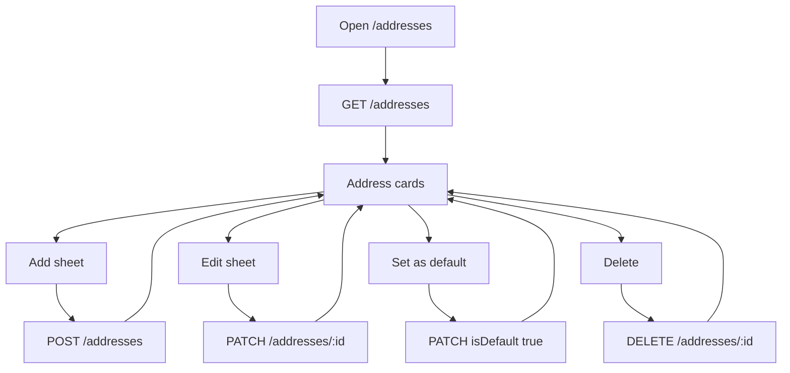
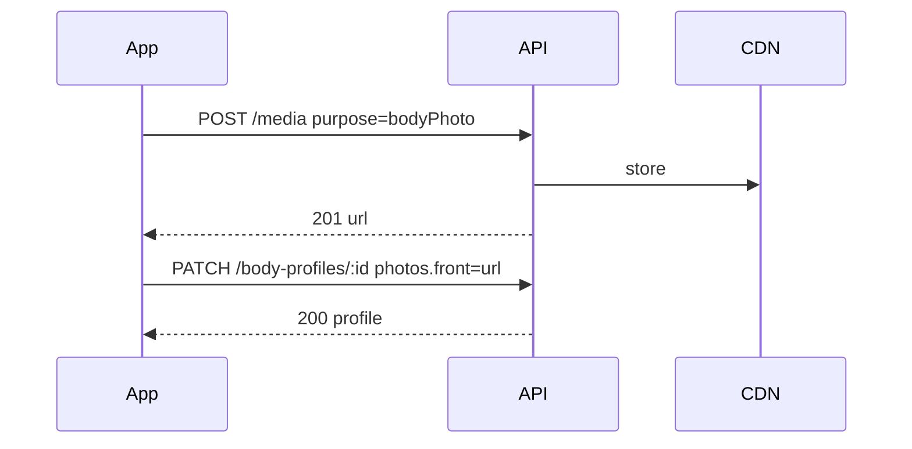
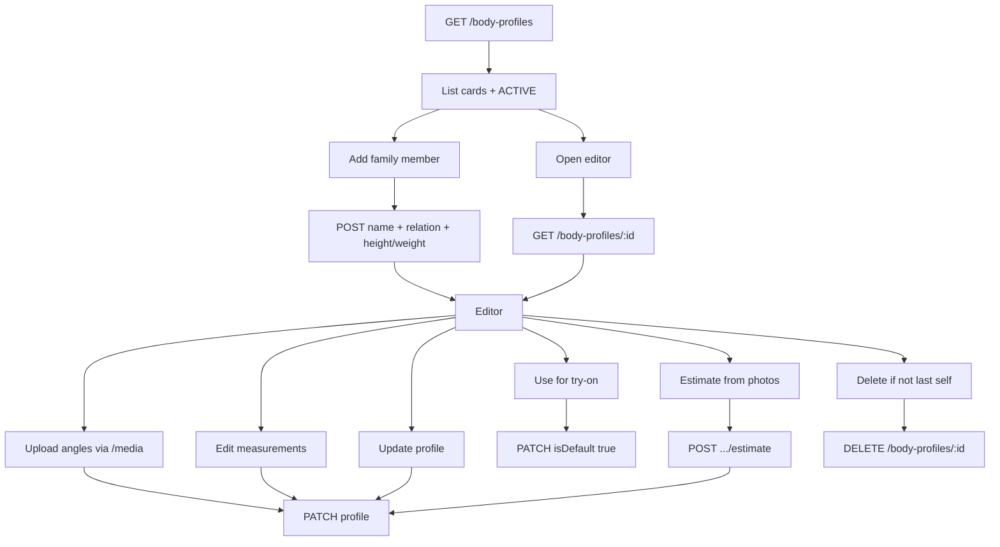
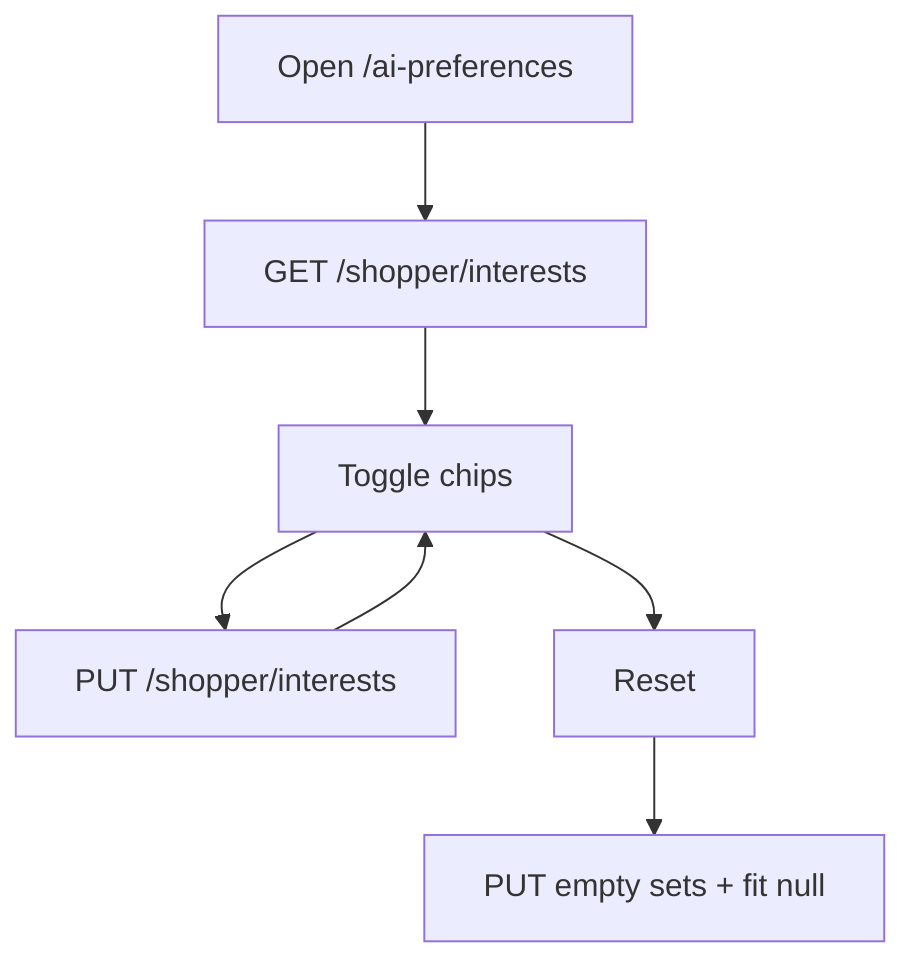
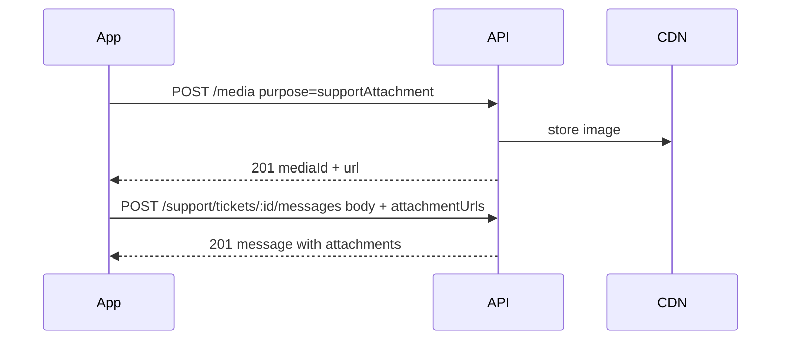
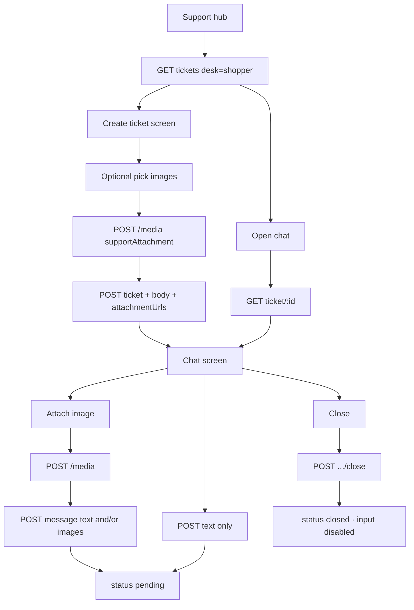
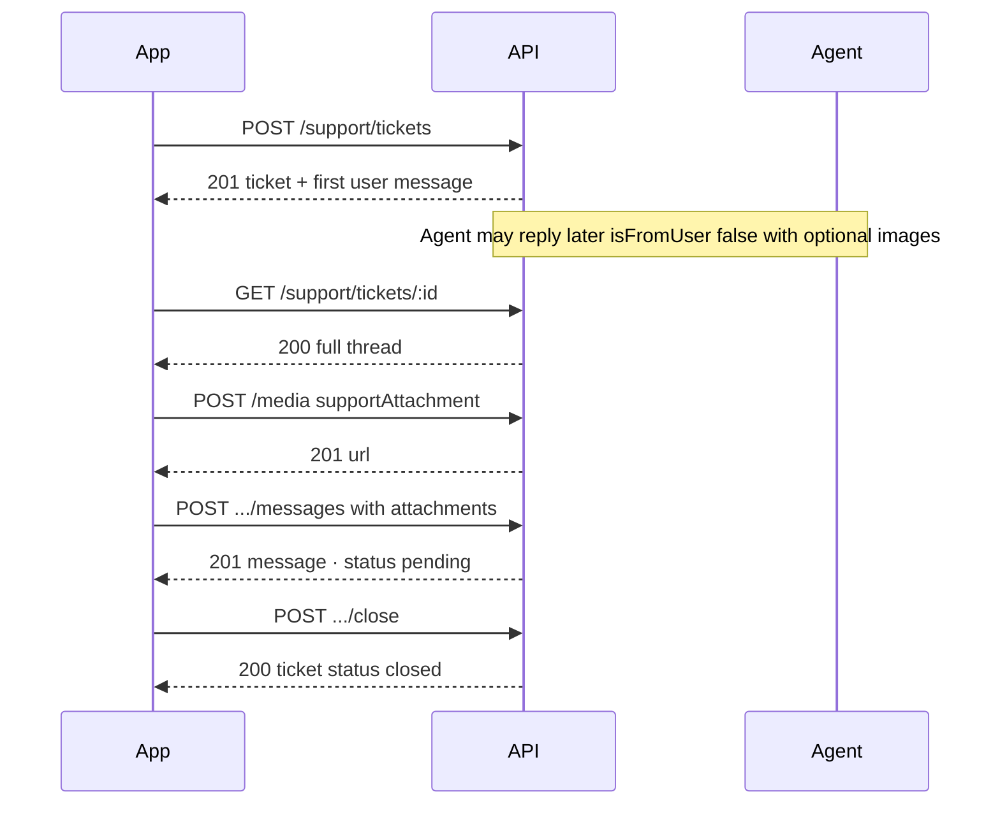

# Redress shopper account flows

**Version 1.0 — 5 October 2026**

Base URL:

```text
https://redressbackend.cyberimpulses.com/api/v1
```

This document is the Flutter handoff contract for shopper **account, fit, taste, help content, and support chat** screens that today run on local demo data. It complements `auth-flows.md` (login/session) and does not redefine seller catalogue, cart, checkout, or try-on jobs.

Verified against the app screens:

| App route | Screen |
| --- | --- |
| `/addresses` | Address book |
| `/body-profiles` | Body profiles list |
| `/body-profiles/:profileId` | Body profile editor |
| `/ai-preferences` | AI Preferences (shopper interests) |
| `/support` | Help hub (FAQ sheet, email, tickets entry, policies) |
| `/support/tickets` | Ticket list |
| `/support/tickets/new` | Create ticket → start chat |
| `/support/tickets/:id` | Support chat (close when resolved) |
| `/policies` | Policy index |
| `/policies/:id` | Policy detail |

---

## Shared rules

Headers on every call:

```http
Accept: application/json
Content-Type: application/json
Accept-Language: it
```

`it` or `en`. Missing or anything else means Italian. Protected calls also send:

```http
Authorization: Bearer <accessToken>
```

Success body shape:

```json
{ "data": {} }
```

Paginated lists:

```json
{
  "data": [],
  "page": {
    "limit": 20,
    "nextCursor": null,
    "hasMore": false,
    "total": 0
  }
}
```

Errors use the same contract as auth:

```json
{
  "errorCode": "VALIDATION",
  "messageKey": "errorValidation",
  "details": {
    "retryable": false,
    "fields": {}
  }
}
```

| HTTP | errorCode | When |
| --- | --- | --- |
| 400 | `VALIDATION` | Bad shape or missing required field |
| 401 | `SESSION_EXPIRED` / `SESSION_CLOSED` | Access/refresh session finished |
| 403 | `FORBIDDEN` | Signed in but not allowed |
| 404 | `NOT_FOUND` | Unknown id for this user |
| 409 | `CONFLICT` | Illegal state (e.g. message on closed ticket) |
| 422 | `UNPROCESSABLE` | Valid JSON but business rule failed |
| 429 | `RATE_LIMITED` | Too many writes |

Media uploads use `multipart/form-data` on `POST /media` (JWT required).

| `purpose` | Used for |
| --- | --- |
| `avatar` | Profile photo |
| `bodyPhoto` | Body-profile angle photos |
| `supportAttachment` | Support chat images (create ticket + thread) |

---

## Endpoint index

| # | Method | Path | Auth | Purpose |
| --- | --- | --- | --- | --- |
| 1 | GET | `/addresses` | JWT | List address book |
| 2 | POST | `/addresses` | JWT | Add address |
| 3 | PATCH | `/addresses/:id` | JWT | Edit / set default |
| 4 | DELETE | `/addresses/:id` | JWT | Remove address |
| 5 | GET | `/body-profiles` | JWT | List body profiles |
| 6 | POST | `/body-profiles` | JWT | Create profile |
| 7 | GET | `/body-profiles/:id` | JWT | Read one profile |
| 8 | PATCH | `/body-profiles/:id` | JWT | Update profile / measurements / photos / active |
| 9 | DELETE | `/body-profiles/:id` | JWT | Delete non-self / extra profile |
| 10 | POST | `/body-profiles/:id/estimate` | JWT | Estimate measurements from photos (async ok) |
| 11 | GET | `/shopper/interests` | JWT | Fetch AI preferences |
| 12 | PUT | `/shopper/interests` | JWT | Replace AI preferences |
| 13 | GET | `/content/faq` | Public | FAQ items for Support sheet |
| 14 | GET | `/content/policies` | Public | Policy index |
| 15 | GET | `/content/policies/:id` | Public | One policy document |
| 16 | GET | `/support/tickets` | JWT | Ticket list (paginated) |
| 17 | POST | `/support/tickets` | JWT | Create ticket + first message |
| 18 | GET | `/support/tickets/:id` | JWT | Ticket thread |
| 19 | POST | `/support/tickets/:id/messages` | JWT | Send chat text and/or images |
| 20 | POST | `/support/tickets/:id/close` | JWT | Shopper closes ticket |

Related media call:

| Method | Path | Auth | Purpose |
| --- | --- | --- | --- |
| POST | `/media` | JWT | Upload one image → CDN URL (`purpose: supportAttachment` for chat) |

---

## 1. Address book

Powers `/addresses` and checkout address selection.

### Object

```json
{
  "id": "adr_01",
  "label": "Home",
  "fullName": "Ada Rossi",
  "phone": "+393331234567",
  "line1": "Via Roma 1",
  "line2": "",
  "city": "Milano",
  "state": "MI",
  "postalCode": "20121",
  "country": "IT",
  "isDefault": true
}
```

| Field | Rule |
| --- | --- |
| `label` | Required, 1–40 chars. App chips use Home / Office; free text allowed |
| `fullName` | Required, 2–80 chars |
| `phone` | Required, E.164 |
| `line1` | Required, 1–120 chars |
| `line2` | Optional, max 120 |
| `city` | Required, 1–80 |
| `state` | Required, 1–80 (region / province) |
| `postalCode` | Required, 2–20 |
| `country` | Required ISO-3166-1 alpha-2 (`IT`, `IN`, …). App may show “Italy” from a local map |
| `isDefault` | At most one `true` per user |

### Flow



### `GET /addresses`

Auth: JWT. Not paginated.

Response `200`:

```json
{
  "data": [
    {
      "id": "adr_01",
      "label": "Home",
      "fullName": "Ada Rossi",
      "phone": "+393331234567",
      "line1": "Via Roma 1",
      "line2": "",
      "city": "Milano",
      "state": "MI",
      "postalCode": "20121",
      "country": "IT",
      "isDefault": true
    },
    {
      "id": "adr_02",
      "label": "Office",
      "fullName": "Ada Rossi",
      "phone": "+393331234567",
      "line1": "Corso Buenos Aires 10",
      "line2": "Floor 3",
      "city": "Milano",
      "state": "MI",
      "postalCode": "20124",
      "country": "IT",
      "isDefault": false
    }
  ]
}
```

Empty book: `{ "data": [] }`.

### `POST /addresses`

Auth: JWT.

```json
{
  "label": "Home",
  "fullName": "Ada Rossi",
  "phone": "+393331234567",
  "line1": "Via Roma 1",
  "line2": "",
  "city": "Milano",
  "state": "MI",
  "postalCode": "20121",
  "country": "IT",
  "isDefault": true
}
```

Rules:

- First address always becomes default even if `isDefault` is omitted.
- `isDefault: true` clears the previous default.
- Response `201`: `{ "data": <address> }`.

### `PATCH /addresses/:id`

Auth: JWT. Partial update. Any field except `id`.

```json
{ "city": "Roma", "postalCode": "00100", "isDefault": true }
```

Response `200`: `{ "data": <address> }`. Unknown id for this user → `404`.

### `DELETE /addresses/:id`

Auth: JWT. Response `204`.

If the deleted row was default, promote the newest remaining address to default. If none remain, book is empty.

### Flutter mapping

| UI action | API |
| --- | --- |
| Open book | `GET /addresses` |
| Save new | `POST /addresses` |
| Save edit | `PATCH /addresses/:id` |
| Set as default | `PATCH /addresses/:id` `{ "isDefault": true }` |
| Delete | `DELETE /addresses/:id` |
| Checkout selected address | Use `id` as `addressId` on checkout (existing order contract) |

Local selection (`selectedId`) may stay on device for UX; server source of truth for default is `isDefault`.

---

## 2. Body profiles

Powers `/body-profiles` and `/body-profiles/:profileId`. Used later by fit recommendation and Style Studio.

### Object

```json
{
  "id": "bp_01",
  "name": "Ada",
  "relation": "self",
  "isDefault": true,
  "avatarUrl": null,
  "photos": {
    "front": "https://cdn.example.com/body/front.jpg",
    "back": null,
    "left": null,
    "right": null
  },
  "measurements": {
    "heightCm": 170,
    "weightKg": 62,
    "shouldersCm": 40,
    "chestCm": 92,
    "waistCm": 74,
    "hipsCm": 98,
    "inseamCm": 78,
    "armLengthCm": 58,
    "shoeEu": 38,
    "footLengthCm": 24.5
  },
  "stylist": {
    "sensations": ["Confident", "Elegant"],
    "favoriteColors": ["black", "navy"],
    "avoidColors": [],
    "rhythm": "classic",
    "usualSize": "M",
    "activeLearning": true
  },
  "updatedAt": "2026-10-05T08:00:00.000Z"
}
```

| Field | Rule |
| --- | --- |
| `name` | Required, 2–40 chars |
| `relation` | `self` \| `partner` \| `child` \| `other` |
| `isDefault` | Active profile for try-on / fit. Exactly one `true` when any profiles exist |
| `photos` | Keys `front`, `back`, `left`, `right`. Values HTTPS CDN URL or `null` |
| `measurements.heightCm` | Required on create, 80–250 |
| `measurements.weightKg` | Required on create, 20–300 |
| Other measurements | Optional numbers |
| `stylist` | Optional; per-profile notes (separate from account AI interests) |
| Ready for try-on (client rule) | ≥ 1 photo and both height + weight set |

### Photo upload



`POST /media` (multipart):

| Part | Value |
| --- | --- |
| `purpose` | `bodyPhoto` |
| `file` | JPEG/PNG/WebP, max 8 MB |

Response `201`:

```json
{
  "data": {
    "id": "med_01",
    "url": "https://cdn.example.com/body/front.jpg",
    "purpose": "bodyPhoto"
  }
}
```

### Flow



### `GET /body-profiles`

Auth: JWT. Paginated (`limit`, `cursor`). Default sort: default first, then newest.

Response `200`:

```json
{
  "data": [
    {
      "id": "bp_01",
      "name": "Ada",
      "relation": "self",
      "isDefault": true,
      "avatarUrl": null,
      "photos": {
        "front": "https://cdn.example.com/body/front.jpg",
        "back": null,
        "left": null,
        "right": null
      },
      "measurements": {
        "heightCm": 170,
        "weightKg": 62,
        "chestCm": 92,
        "waistCm": 74,
        "hipsCm": 98
      },
      "stylist": {
        "usualSize": "M",
        "activeLearning": true
      },
      "updatedAt": "2026-10-05T08:00:00.000Z"
    }
  ],
  "page": { "limit": 20, "nextCursor": null, "hasMore": false, "total": 1 }
}
```

### `POST /body-profiles`

Auth: JWT.

Minimum create (matches “Add family member” then editor fill-in):

```json
{
  "name": "Luca",
  "relation": "partner",
  "measurements": {
    "heightCm": 178,
    "weightKg": 74
  }
}
```

Rules:

- First profile for the account must use `relation: self` (or server creates a self seed on first signup — either is fine; Flutter currently seeds “Me”).
- At most one `self` profile per user.
- New profile is not default unless it is the first profile, or client sends `isDefault: true`.
- Response `201`: `{ "data": <body profile> }`.

### `GET /body-profiles/:id`

Auth: JWT. Response `200`: `{ "data": <body profile> }`. Other user’s id → `404`.

### `PATCH /body-profiles/:id`

Auth: JWT. Partial. Sending `measurements` **merges** by field (null clears that field). Sending `photos` **merges** by angle (null clears that angle).

```json
{
  "name": "Ada Rossi",
  "photos": {
    "front": "https://cdn.example.com/body/front.jpg",
    "left": null
  },
  "measurements": {
    "heightCm": 171,
    "weightKg": 62,
    "chestCm": 93
  },
  "isDefault": true
}
```

Set active (“Use for try-on”):

```json
{ "isDefault": true }
```

Response `200`: `{ "data": <body profile> }`.

`relation` is immutable after create (matches read-only relation in editor). Changing it → `422` `UNPROCESSABLE`, `details.fields.relation = "immutable"`.

### `DELETE /body-profiles/:id`

Auth: JWT. Response `204`.

| Case | Result |
| --- | --- |
| Delete last remaining profile | `422`, `details.reason = last_profile` |
| Delete the only `self` while others exist | `422`, `details.reason = self_required` (keep one self) |
| Delete default while others remain | Promote another (prefer `self`, else newest) |

### `POST /body-profiles/:id/estimate`

Auth: JWT. Uses stored photos to suggest measurements. At least one photo required.

Request: empty object `{}` or omit body.

Response `202` (async):

```json
{
  "data": {
    "id": "est_01",
    "bodyProfileId": "bp_01",
    "status": "queued"
  }
}
```

Or synchronous `200` when the backend can fill immediately:

```json
{
  "data": {
    "bodyProfileId": "bp_01",
    "status": "completed",
    "measurements": {
      "chestCm": 92,
      "waistCm": 74,
      "hipsCm": 98,
      "shouldersCm": 40
    },
    "profile": { "...": "full body profile after merge" }
  }
}
```

No photos → `422`, `details.fields.photos = "required"`. Mark experimental in UI (already labelled).

### Flutter mapping

| UI | API |
| --- | --- |
| Open list | `GET /body-profiles` |
| Add family member | `POST /body-profiles` then open editor |
| Open editor | `GET /body-profiles/:id` (or use list cache) |
| Pick photo angle | `POST /media` → `PATCH` photos |
| Clear photo | `PATCH` that angle `null` |
| Save measurements / name | `PATCH /body-profiles/:id` |
| Use for try-on | `PATCH` `{ "isDefault": true }` |
| Estimate from photos | `POST /body-profiles/:id/estimate` |
| Delete | `DELETE /body-profiles/:id` |

Account-level AI Preferences (`/ai-preferences`) are **not** stored inside `stylist`. Keep them on `/shopper/interests`.

---

## 3. AI preferences (shopper interests)

Powers `/ai-preferences`. Teaches Redress taste for discovery / recommendations. One document per shopper account.

### Object

Option ids are stable English keys. Labels come from app l10n (`it` / `en`).

```json
{
  "shopFor": ["women", "unisex"],
  "styles": ["casual", "minimal", "elegant"],
  "occasions": ["work", "weekend"],
  "colors": ["black", "navy", "beige"],
  "fit": "regular",
  "goals": ["essentials", "sustainable"],
  "updatedAt": "2026-10-05T08:00:00.000Z"
}
```

| Field | Type | Allowed values |
| --- | --- | --- |
| `shopFor` | string[] | `women`, `men`, `kids`, `unisex` |
| `styles` | string[] | `casual`, `street`, `minimal`, `formal`, `sporty`, `elegant`, `boho`, `vintage` |
| `occasions` | string[] | `work`, `weekend`, `party`, `travel`, `gym`, `date` |
| `colors` | string[] | `black`, `white`, `navy`, `beige`, `grey`, `earth`, `bright`, `pastel` |
| `fit` | string \| null | `slim`, `regular`, `relaxed`, `oversized` |
| `goals` | string[] | `trends`, `essentials`, `sustainable`, `value`, `premium` |

Unknown ids → `400` `VALIDATION`. Duplicates are ignored. Empty arrays and `fit: null` mean “no preference” (Reset).

### Flow



### `GET /shopper/interests`

Auth: JWT.

Response `200` when never set:

```json
{
  "data": {
    "shopFor": [],
    "styles": [],
    "occasions": [],
    "colors": [],
    "fit": null,
    "goals": [],
    "updatedAt": null
  }
}
```

### `PUT /shopper/interests`

Auth: JWT. Full replace (matches chip UI + Reset).

```json
{
  "shopFor": ["women"],
  "styles": ["casual", "elegant"],
  "occasions": ["work"],
  "colors": ["black", "beige"],
  "fit": "regular",
  "goals": ["essentials"]
}
```

Response `200`: `{ "data": <interests including updatedAt> }`.

### Flutter mapping

| UI | API |
| --- | --- |
| Open screen | `GET /shopper/interests` |
| Toggle any chip / change fit | Debounce then `PUT` full object |
| Reset | `PUT` all empty + `fit: null` |

No auth gate today in the router; API still requires JWT. Guest open should redirect to login (recommended) or keep local-only until signed in.

---

## 4. Help content — FAQ and policies

Powers Support FAQ sheet and `/policies`, `/policies/:id`. Public so guests can read legal pages before signup.

Policy ids used by the app:

| id | Document |
| --- | --- |
| `privacy` | Privacy policy |
| `terms` | Terms & conditions / Terms of use |
| `shipping` | Shipping policy |
| `returns` | Return policy |
| `cookies` | Cookies & local data (optional; already in app catalog) |

### FAQ object

```json
{
  "id": "faq_01",
  "sortOrder": 1,
  "question": "How does AI size recommendation work?",
  "answer": "We combine your body profile measurements with the product size chart…"
}
```

Text follows `Accept-Language`.

### Policy object

```json
{
  "id": "privacy",
  "title": "Privacy policy",
  "updatedAt": "2026-10-01T00:00:00.000Z",
  "sections": [
    {
      "heading": "What we collect",
      "body": "Account, orders, body photos you upload…"
    }
  ]
}
```

### Flow

```mermaid
flowchart TD
  support[Open /support] --> faqTap[FAQ tile]
  support --> polTap[Policies tile]
  faqTap --> faq[GET /content/faq]
  faq --> sheet[Bottom sheet Q and A]
  polTap --> index[GET /content/policies]
  index --> list[/policies list]
  list --> detail[GET /content/policies/:id]
  detail --> page[/policies/:id]
```

### `GET /content/faq`

Auth: Public.

Response `200`:

```json
{
  "data": [
    {
      "id": "faq_01",
      "sortOrder": 1,
      "question": "How does AI size recommendation work?",
      "answer": "We combine your body profile with each product size chart to suggest a size."
    },
    {
      "id": "faq_02",
      "sortOrder": 2,
      "question": "Can I return a try-on purchase?",
      "answer": "Yes. Eligible orders can be returned within 14 days under the return policy."
    },
    {
      "id": "faq_03",
      "sortOrder": 3,
      "question": "Is my body scan private?",
      "answer": "Body photos and measurements stay on your account and are not sold to other shoppers."
    }
  ]
}
```

### `GET /content/policies`

Auth: Public.

Response `200` (index cards; sections may be omitted for bandwidth):

```json
{
  "data": [
    {
      "id": "privacy",
      "title": "Privacy policy",
      "updatedAt": "2026-10-01T00:00:00.000Z"
    },
    {
      "id": "terms",
      "title": "Terms of use",
      "updatedAt": "2026-10-01T00:00:00.000Z"
    },
    {
      "id": "shipping",
      "title": "Shipping policy",
      "updatedAt": "2026-10-01T00:00:00.000Z"
    },
    {
      "id": "returns",
      "title": "Return policy",
      "updatedAt": "2026-10-01T00:00:00.000Z"
    },
    {
      "id": "cookies",
      "title": "Cookies and local data",
      "updatedAt": "2026-10-01T00:00:00.000Z"
    }
  ]
}
```

### `GET /content/policies/:id`

Auth: Public. Path `id` ∈ `privacy` \| `terms` \| `shipping` \| `returns` \| `cookies`.

Response `200`:

```json
{
  "data": {
    "id": "returns",
    "title": "Return policy",
    "updatedAt": "2026-10-01T00:00:00.000Z",
    "sections": [
      {
        "heading": "Window",
        "body": "You may request a return within 14 days of delivery for eligible items."
      },
      {
        "heading": "Condition",
        "body": "Items must be unused, with original tags, unless the fault is ours."
      },
      {
        "heading": "Try-on purchases",
        "body": "Orders placed after a virtual try-on follow the same return rules as other fashion orders."
      }
    ]
  }
}
```

Unknown id → `404`.

### Flutter mapping

| UI | API |
| --- | --- |
| Support → FAQ sheet | `GET /content/faq` |
| `/policies` list | `GET /content/policies` |
| `/policies/:id` | `GET /content/policies/:id` |
| Settings → Privacy | `GET /content/policies/privacy` |

Until CMS is live, the app may keep `PolicyCatalog` as offline fallback when these calls fail.

---

## 5. Message support (tickets + chat)

Powers `/support/tickets`, `/support/tickets/new`, `/support/tickets/:id`.

Shopper and seller desks share the same ticket model. This section focuses on **shopper** (`desk: shopper`). Seller uses the same endpoints with seller categories and an active seller account.

### Status

| status | Meaning | Shopper can send messages |
| --- | --- | --- |
| `open` | Just created | Yes |
| `pending` | Waiting on support (after shopper reply) | Yes |
| `resolved` | Agent marked done | Yes (reply reopens to `pending`) |
| `closed` | Shopper closed / terminal | No — show closed banner |

### Shopper categories

`order` · `fit` · `tryOn` · `returns` · `account` · `other`

### Objects

Ticket (list item may omit `messages`):

```json
{
  "id": "tck_01",
  "desk": "shopper",
  "subject": "Where is my order?",
  "category": "order",
  "status": "open",
  "createdAt": "2026-10-05T08:00:00.000Z",
  "updatedAt": "2026-10-05T08:00:00.000Z"
}
```

Message attachment:

```json
{
  "id": "att_01",
  "mediaId": "med_88",
  "url": "https://cdn.example.com/support/damaged-box.jpg",
  "mimeType": "image/jpeg",
  "width": 1200,
  "height": 1600,
  "bytes": 482193
}
```

Message:

```json
{
  "id": "msg_01",
  "body": "Order ord_01 has no tracking yet.",
  "attachments": [],
  "isFromUser": true,
  "createdAt": "2026-10-05T08:00:00.000Z"
}
```

| Field | Rule |
| --- | --- |
| `body` | Optional string when `attachments` is non-empty. Trimmed. Max 4000 chars |
| `attachments` | Optional array, 0–5 images per message. Default `[]` |
| `isFromUser` | `true` = shopper, `false` = support agent |

A message must have **either** a non-empty `body`, **or** at least one attachment, or both.

### Chat images

Shopper (and agent) can attach photos in create-ticket and in the chat composer (product damage, packing slip, fit issue, etc.).



#### `POST /media` for support

Auth: JWT. `multipart/form-data`.

| Part | Value |
| --- | --- |
| `purpose` | `supportAttachment` |
| `file` | JPEG, PNG, or WebP. Max 8 MB |

Response `201`:

```json
{
  "data": {
    "id": "med_88",
    "url": "https://cdn.example.com/support/damaged-box.jpg",
    "purpose": "supportAttachment",
    "mimeType": "image/jpeg",
    "width": 1200,
    "height": 1600,
    "bytes": 482193
  }
}
```

Rules:

- Max **5** images per message.
- Only URLs previously uploaded by **this user** with `purpose: supportAttachment` are accepted on the ticket APIs.
- Foreign or expired media ids → `422` `UNPROCESSABLE`, `details.fields.attachments = "invalid"`.
- Closed ticket → no upload required, but message send still returns `409`.
- Client shows image thumbnails in the bubble; tap opens full-screen preview.

### Flow





### `GET /support/tickets`

Auth: JWT.

Query:

| Param | Rule |
| --- | --- |
| `desk` | Required. Shopper app sends `shopper` |
| `status` | Optional filter |
| `limit`, `cursor` | Pagination |

Response `200`:

```json
{
  "data": [
    {
      "id": "tck_01",
      "desk": "shopper",
      "subject": "Where is my order?",
      "category": "order",
      "status": "pending",
      "createdAt": "2026-10-05T08:00:00.000Z",
      "updatedAt": "2026-10-05T09:00:00.000Z"
    }
  ],
  "page": { "limit": 20, "nextCursor": null, "hasMore": false, "total": 1 }
}
```

### `POST /support/tickets`

Auth: JWT.

Text only:

```json
{
  "desk": "shopper",
  "subject": "Where is my order?",
  "category": "order",
  "body": "Order ord_01 has no tracking yet."
}
```

With images (upload first via `/media`):

```json
{
  "desk": "shopper",
  "subject": "Damaged parcel",
  "category": "order",
  "body": "Box arrived crushed. Photos attached.",
  "attachmentUrls": [
    "https://cdn.example.com/support/damaged-box.jpg",
    "https://cdn.example.com/support/label.jpg"
  ]
}
```

Image-only first message (caption optional):

```json
{
  "desk": "shopper",
  "subject": "Fit issue",
  "category": "fit",
  "body": "",
  "attachmentUrls": [
    "https://cdn.example.com/support/fit-front.jpg"
  ]
}
```

| Field | Rule |
| --- | --- |
| `desk` | Required `shopper` (or `seller` for partner desk) |
| `subject` | Optional; if blank, server may use category label. Max 120 |
| `category` | Required shopper category |
| `body` | Optional if `attachmentUrls` has 1–5 items; otherwise required 1–4000 chars |
| `attachmentUrls` | Optional. 0–5 HTTPS URLs from this user’s `supportAttachment` uploads |

Response `201`:

```json
{
  "data": {
    "id": "tck_01",
    "desk": "shopper",
    "subject": "Damaged parcel",
    "category": "order",
    "status": "open",
    "createdAt": "2026-10-05T08:00:00.000Z",
    "updatedAt": "2026-10-05T08:00:00.000Z",
    "messages": [
      {
        "id": "msg_01",
        "body": "Box arrived crushed. Photos attached.",
        "attachments": [
          {
            "id": "att_01",
            "mediaId": "med_88",
            "url": "https://cdn.example.com/support/damaged-box.jpg",
            "mimeType": "image/jpeg",
            "width": 1200,
            "height": 1600,
            "bytes": 482193
          },
          {
            "id": "att_02",
            "mediaId": "med_89",
            "url": "https://cdn.example.com/support/label.jpg",
            "mimeType": "image/jpeg",
            "width": 1080,
            "height": 1440,
            "bytes": 310224
          }
        ],
        "isFromUser": true,
        "createdAt": "2026-10-05T08:00:00.000Z"
      }
    ]
  }
}
```

App navigates to `/support/tickets/{id}` (Start chat). Do **not** invent client-side agent auto-replies in production; real agent messages arrive as `isFromUser: false` on later fetches (or push), and may also include `attachments`.

### `GET /support/tickets/:id`

Auth: JWT. Response `200` includes full `messages` ordered oldest → newest, each with `attachments` (possibly empty). Another user’s ticket → `404`.

### `POST /support/tickets/:id/messages`

Auth: JWT.

Text only:

```json
{ "body": "Any update on tracking?" }
```

Text + images:

```json
{
  "body": "Here is a clearer photo of the stain.",
  "attachmentUrls": [
    "https://cdn.example.com/support/stain-closeup.jpg"
  ]
}
```

Images only:

```json
{
  "body": "",
  "attachmentUrls": [
    "https://cdn.example.com/support/size-tag.jpg",
    "https://cdn.example.com/support/inside-label.jpg"
  ]
}
```

| Field | Rule |
| --- | --- |
| `body` | Optional when attachments present; else required. Max 4000 |
| `attachmentUrls` | Optional, 0–5. Must be this user’s `supportAttachment` URLs |

Response `201`:

```json
{
  "data": {
    "id": "msg_02",
    "body": "Here is a clearer photo of the stain.",
    "attachments": [
      {
        "id": "att_03",
        "mediaId": "med_90",
        "url": "https://cdn.example.com/support/stain-closeup.jpg",
        "mimeType": "image/jpeg",
        "width": 1440,
        "height": 1920,
        "bytes": 520441
      }
    ],
    "isFromUser": true,
    "createdAt": "2026-10-05T10:00:00.000Z"
  }
}
```

Side effects:

- Ticket `status` becomes `pending` (unless already `closed`).
- `updatedAt` refreshes.
- If status was `resolved`, reply reopens to `pending`.

`closed` ticket → `409` `CONFLICT`, `details.reason = ticket_closed`.

Empty body **and** empty/missing attachments → `400` `VALIDATION`, `details.fields.body = "required"`.

More than 5 URLs → `400` `VALIDATION`, `details.fields.attachmentUrls = "max"`.

### `POST /support/tickets/:id/close`

Auth: JWT. Shopper taps Close on chat screen.

Request: `{}` or empty body.

Response `200`:

```json
{
  "data": {
    "id": "tck_01",
    "desk": "shopper",
    "subject": "Where is my order?",
    "category": "order",
    "status": "closed",
    "createdAt": "2026-10-05T08:00:00.000Z",
    "updatedAt": "2026-10-05T11:00:00.000Z",
    "messages": []
  }
}
```

`messages` may be omitted on close response; client should keep the local thread or re-fetch. Already `closed` → `200` idempotent.

Ops/agent may set `resolved` through an internal tool; Flutter only needs to **display** `resolved` and still allow chat until the shopper closes.

### Flutter mapping

| UI | API |
| --- | --- |
| Ticket list | `GET /support/tickets?desk=shopper` |
| Create → Start chat | optional `/media` × N → `POST /support/tickets` → push `/:id` |
| Open chat | `GET /support/tickets/:id` (render text + image bubbles) |
| Attach image in composer | `POST /media` (`purpose: supportAttachment`) |
| Send | `POST .../messages` with `body` and/or `attachmentUrls` |
| Close | `POST .../close` → disable composer |
| Email tile | Device mail to `hello@redress.global` (no API) |

Guest lock on tickets stays: require login before list/create/chat.

---

## 6. Screen → API checklist

| Screen | On open | Mutations |
| --- | --- | --- |
| Address book | `GET /addresses` | POST / PATCH / DELETE |
| Body profiles list | `GET /body-profiles` | POST create, PATCH default, DELETE |
| Body profile editor | `GET /body-profiles/:id` | `/media` + PATCH, estimate, DELETE |
| AI Preferences | `GET /shopper/interests` | `PUT /shopper/interests` |
| Support hub FAQ | `GET /content/faq` | — |
| Policies list / detail | `GET /content/policies` (+ `/:id`) | — |
| Tickets list | `GET /support/tickets?desk=shopper` | — |
| Create ticket | — | `/media` (optional) + `POST /support/tickets` |
| Support chat | `GET /support/tickets/:id` | `/media` + messages + close |

---

## 7. Recommended backend build order

1. Addresses (needed for checkout).
2. Content FAQ + policies (public, unblocks Support/Settings copy).
3. Support tickets list/create/get/message/close + `supportAttachment` media.
4. Body profiles CRUD + media `bodyPhoto` + `isDefault`.
5. Optional estimate job.
6. Shopper interests GET/PUT.
7. Wire Flutter controllers off SharedPreferences onto these endpoints.

---

## 8. Notes vs current demo app

| Topic | Demo app today | This contract |
| --- | --- | --- |
| Addresses | SharedPreferences | REST above |
| Country | Free text e.g. “Italy” | ISO `IT` (+ local display map) |
| Body photos | Local file paths | CDN URLs via `/media` |
| Active profile | Local `activeId` | `isDefault` on server |
| AI preferences | Local only | `/shopper/interests` |
| Policies | Bundled l10n (+ cookies) | CMS + **returns** id |
| FAQ | Hard-coded 3 strings | `/content/faq` |
| Ticket close | Local status flip | `POST .../close` |
| Ticket `resolved` | Never set in app | Agent-side; UI must render chip |
| Chat images | Not in demo composer yet | `/media` + `attachmentUrls` / `attachments` |
| Agent auto-reply | Fake local message | Real agent messages only |

Auth, logout, and profile credential APIs remain in `auth-flows.md`.
